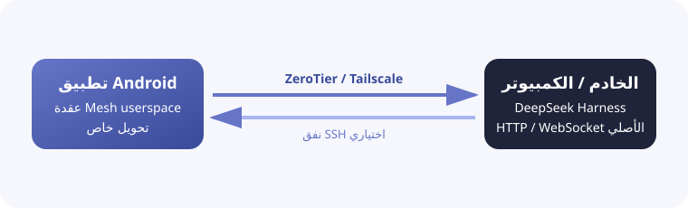

<h1 align="center">DSH Mobile Mesh</h1>

<a href="README.md">English</a> · <a href="README.zh-CN.md">中文</a> · <a href="README.hi.md">हिन्दी</a> · <a href="README.es.md">Español</a> · <a href="README.fr.md">Français</a> · <b>العربية</b> · <a href="README.bn.md">বাংলা</a> · <a href="README.pt.md">Português</a> · <a href="README.ru.md">Русский</a> · <a href="README.ur.md">اردو</a> · <a href="README.th.md">ไทย</a>

## الميزات

DSH Mobile Mesh هو تطبيق Android غير رسمي للتحكم عن بُعد في [DeepSeek Harness](https://github.com/deepseek-ai/deepseek-harness). يستمر تشغيل Agent وShell والملفات وworkspace على الخادم الذي ثُبّت عليه DeepSeek Harness.

- تصفح مساحات العمل والجلسات والسجل والردود المباشرة.
- عرض نتائج الأدوات وإرسال النصوص والصور والملفات.
- إدارة الأهداف والخطط والموافقات والأسئلة والمهام وسير العمل والوكلاء الفرعيين.
- تغيير النماذج والإعدادات والمهارات وتشغيل أوامر DeepSeek Harness.

### اتصال Mesh

يُشغّل التطبيق داخل Android شبكة ZeroTier/libzt أو Tailscale/tsnet بوضع userspace، ويحوّل واجهة HTTP/WebSocket الأصلية لـ DeepSeek Harness إلى الهاتف. لا يحتاج DeepSeek Harness إلى تغيير طريقة التشغيل أو تثبيت إضافة، ولا يلزم استخدام VPN على مستوى نظام Android. يمكن إضافة SSH إلى Direct أو ZeroTier أو Tailscale، مع إبقاء DeepSeek Harness مستمعاً على `127.0.0.1`.

## الاستخدام

1. شغّل `dsh web` على الخادم.
2. قبل استخدام ZeroTier أو Tailscale، ثبّت وسجّل دخول العقدة المناسبة على الخادم الذي يعمل عليه DeepSeek Harness: ثبّت [ZeroTier](https://www.zerotier.com/download/) وانضم إلى الشبكة نفسها الموجودة في التطبيق، أو ثبّت [Tailscale](https://tailscale.com/docs/install) وسجّل الدخول إلى Tailnet نفسه.
3. نزّل APK من [GitHub Releases](https://github.com/sorsama/deepseek-harness-mobile/releases).
4. اختر Direct أو ZeroTier أو Tailscale؛ SSH طبقة اختيارية للطرق الثلاث.
5. أدخل رمز تشغيل DeepSeek Harness عند الطلب.

## الأمان

يمكن لـ DeepSeek Harness تنفيذ الأوامر وقراءة الملفات وكتابتها على المضيف. لا تعرض منفذاً غير محمي للإنترنت واحفظ الرموز ومفاتيح SSH وبيانات Mesh بأمان.

## التوافق وخط أساس البروتوكول

يتبع خط أساس DTO في تطبيق Android إصدار DeepSeek Harness `v0.2.1-rc.2` (commit `687f282e86`)، والذي يتضمن لقطة الاستبدال الكاملة لـ`workspace/follow`، ومعرّف `session/create` الذي يحدده Host، وإدخال `terminal/attach` القائم على الإقرارات الذي أُضيف خلال السلسلة 0.2.1 alpha. وتعرض إعدادات التطبيق ولوحة تفاصيل الاتصال خط الأساس هذا نفسه. عند الاتصال، يستخدم التطبيق فحصي `session/list` و`session/projections` الحاليين للقراءة فقط، ويخزن القدرات المكتشفة لإعادة الاتصال؛ ولا يستنتج الدعم من رقم الإصدار. إذا لم يتوفر مسار projection في خادم قديم، يستمر التطبيق باستخدام واجهة subagent القديمة.

لم يغيّر تحديث `v0.2.1-rc.2` أي نقطة نهاية يستدعيها هذا التطبيق: تغييرات حقول إشعارات الحساب تخص `account/getUnnotifiedBonuses` الذي لا يستخدمه عميل Android، وتغييرات عميل terminal هي تخزين مؤقت لاكتشاف في المتصفح فوق استجابة `terminal/list` غير المتغيرة. لذلك تواصل الخوادم القديمة العمل عبر الفحوص نفسها، ولا يعلن التطبيق دعم قدرة بلا مسار يستخدمه فعلياً.

يغطي خط الأساس المعتمد في 0.2.1 أيضاً `workspace/follow`: يقبل `baseline` القديم و`replace` الجديد كحالتين كاملتين تحلان محل مساحات العمل والأرشيف وترتيب التثبيت. تبقى فحوص `session/list` و`session/projections` للقراءة فقط، ويُحذف `session/create.sessionId` افتراضياً ويُستخدم المعرّف المُعاد. يختار الحقل `terminal/environment.maxBufferedBytes` للقراءة فقط البث الثنائي `terminal/attach`؛ وعند غيابه يحتفظ التطبيق بمسار `terminal/follow` القديم وعمليتي write/resize. تنتظر الأوامر المرقمة في كل اتصال إقرار Host قبل إرسال الأمر التالي وتتحقق من حدود نافذة النقل. تُخزَّن نتائج `terminal/list` لكل جلسة وتُشارك بين جميع عروض الطرفية لتلك الجلسة، وتُعاد قراءتها مرة واحدة لكل جيل اتصال جديد؛ ويحدّث الإنشاء والإغلاق المؤكد الصفوف المخزنة، وتبقى استجابة Host المصدر الوحيد لبيانات الطرفية.

يقبل التطبيق استجابة projection القديمة التي لا تحتوي على `kind` واستجابات `session/projections` الجديدة. تُعامل `migration-required` كتلميح بلا تسلسل ولا تُدمج مع مؤشرات الأحداث الحية. يظل `session/list.formatStatus` اختيارياً، ويُحذف `session/fork.allowMigration` افتراضياً للتوافق مع الخوادم القديمة. تُعرض سجلات subagent ذات الوضع `external` كما أرسلها الخادم، لكنها لا تُفتح كسجل محادثة Session. وتشير `terminal/environment.cwd` إلى دليل العمل الحالي الذي سجله الخادم.

## المراجع

- [DeepSeek Harness](https://github.com/deepseek-ai/deepseek-harness)
- [OpenCode Mobile Mesh](https://github.com/chliny/opencode-mobile-mesh)
- [DeepSeek Harness Mobile](https://github.com/sorsama/deepseek-harness-mobile)

## الترخيص

[MIT License](LICENSE). جميع العلامات التجارية تخص أصحابها.
