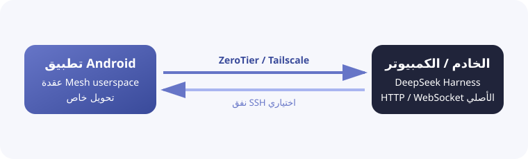

<h1 align="center">DSH Mobile Mesh</h1>

<a href="README.md">English</a> · <a href="README.zh-CN.md">中文</a> · <a href="README.hi.md">हिन्दी</a> · <a href="README.es.md">Español</a> · <a href="README.fr.md">Français</a> · <b>العربية</b> · <a href="README.bn.md">বাংলা</a> · <a href="README.pt.md">Português</a> · <a href="README.ru.md">Русский</a> · <a href="README.ur.md">اردو</a> · <a href="README.th.md">ไทย</a>

## الميزات

DSH Mobile Mesh هو تطبيق Android غير رسمي للتحكم عن بُعد في [DeepSeek Harness](https://github.com/deepseek-ai/deepseek-harness). يستمر تشغيل Agent وShell والملفات وworkspace على الخادم الذي ثُبّت عليه DeepSeek Harness.

- تصفح مساحات العمل والجلسات والسجل والردود المباشرة.
- عرض نتائج الأدوات وإرسال النصوص والصور والملفات.
- إدارة الأهداف والخطط والموافقات والأسئلة والمهام وسير العمل والوكلاء الفرعيين.
- تغيير النماذج والإعدادات والمهارات وتشغيل أوامر DeepSeek Harness.

### اتصال Mesh

يُشغّل التطبيق داخل Android شبكة ZeroTier/libzt أو Tailscale/tsnet بوضع userspace، ويحوّل واجهة HTTP/WebSocket الأصلية لـ DeepSeek Harness إلى الهاتف. لا يحتاج DeepSeek Harness إلى تغيير طريقة التشغيل أو تثبيت إضافة، ولا يلزم استخدام VPN على مستوى نظام Android. يمكن إضافة SSH إلى Direct أو ZeroTier أو Tailscale، مع إبقاء DeepSeek Harness مستمعاً على `127.0.0.1`.

## الاستخدام

1. شغّل `dsh web` على الخادم.
2. قبل استخدام ZeroTier أو Tailscale، ثبّت وسجّل دخول العقدة المناسبة على الخادم الذي يعمل عليه DeepSeek Harness: ثبّت [ZeroTier](https://www.zerotier.com/download/) وانضم إلى الشبكة نفسها الموجودة في التطبيق، أو ثبّت [Tailscale](https://tailscale.com/docs/install) وسجّل الدخول إلى Tailnet نفسه.
3. نزّل APK من [GitHub Releases](https://github.com/sorsama/deepseek-harness-mobile/releases).
4. اختر Direct أو ZeroTier أو Tailscale؛ SSH طبقة اختيارية للطرق الثلاث.
5. أدخل رمز تشغيل DeepSeek Harness عند الطلب.

## الأمان

يمكن لـ DeepSeek Harness تنفيذ الأوامر وقراءة الملفات وكتابتها على المضيف. لا تعرض منفذاً غير محمي للإنترنت واحفظ الرموز ومفاتيح SSH وبيانات Mesh بأمان.

## التوافق وخط أساس البروتوكول

يتتبع خط أساس DTO لبروتوكول تطبيق Android إصدار DeepSeek Harness `v0.2.2-rc.1` (commit `66491b05e3`). وقد فُحصت أنواع النقل أيضاً مقابل `master` في المنبع عند `fcc0ad4621`، وهو متقدم بـ 811 commits عن ذلك الإصدار وليس إصداراً بحد ذاته؛ وحيث غيّر ذلك الفرع شكلاً يستدعيه التطبيق، يحتفظ التطبيق بالشكلين. ويشير خط أساس البروتوكول المعروض في الإعدادات ولوحة تفاصيل الاتصال إلى إصدار `v0.2.2-rc.1`. عند الاتصال، يستخدم التطبيق فحصي `session/list` و`session/projections` الحاليين للقراءة فقط، ويخزن القدرات المرصودة لإعادة الاتصال التلقائي؛ ولا يستنتج القدرات من سلسلة إصدار الخادم. وتواصل الخوادم التي لا تملك مسار projection العمل عبر واجهة subagent القديمة.

يحتفظ `v0.2.2-rc.1` بكل مسار كان هذا التطبيق يستدعيه، لكنه يغيّر ثلاثة أشكال للطلبات. أصبح `session/attachment` يأخذ `ImageAttachmentRef` الكامل بدلاً من `attachmentId` المجرد؛ ويرسل Android العضوين معاً، وتتجاهل الخوادم من الجيلين عضو الطلب الذي لا تعلن عنه، لذا لا تحتاج قراءة الصور إلى أي فحص قدرات. لا يستأنف `session/follow` جلسة عادية مُجهَّزة إلا عندما يضبط الطلب `activate`؛ ويطلب Android التنشيط دائماً، مما يعيد على الخوادم الجديدة سلوك الترقية في الخلفية السابق لـ 0.2.2 ويتجاهله الخوادم القديمة، بينما تبقى سجلات subagent سلبية. قد تحمل إطارات projection في `session/control` عدة تغييرات مفاتيح لحدث مُثبَّت واحد؛ ويطبّع التطبيق إطار المفتاح الواحد القديم ويقبل الشكلين. لم يعد ملخص projection المقلّص في `session/list` يكرر قيماً على مستوى الخادم بأكمله مثل `imageLimits`؛ ويقرؤها التطبيق من `session/projections` وخط أساس التحكم ولا يعتبر مفتاحاً مفقوداً في الملخص قدرة مفقودة أبداً. يُعرض `name` الخاص بـ subagent في الكتالوج الذي يقدمه Host إلى جانب `label` الموجود؛ وعندما لا يقدمه Host قديم يبقى العرض كما هو. تُعرض شارات النماذج من الكتالوج بجانب اسم النموذج، باستخدام النص الإنجليزي من الخادم عند غياب لغة القارئ، ويعرض إدخال إضافة فاشل التشخيص الذي يبلّغ عنه الخادم عند بدء التشغيل. تُعرض لوحة مهام Agent Team المنشورة في projection ‏`agentTeam` للجلسة الحالية في لوحة التفاصيل بترتيب الخادم، بما في ذلك جاهزية الخادم وتحذيرات نطاق الكتابة وإشعار بارز عندما تكون اللوحة مجرد آخر حالة صالحة بعد رفض تحديث؛ ولا يعرض الخادم القديم الذي يفتقر إلى هذا projection أي لوحة.

تعرض لوحة التفاصيل أيضاً حالة الجلسة السلبية للخادم عبر `session/state` وتدفق `session/observeState` للقراءة فقط: مؤشرات active/running، وما إذا كانت قائمة الانتظار المعلّقة قابلة للقراءة وكم عنصراً تحتوي، وفئات المدخلات المعلّقة التي تم أخذ عيّناتها عند آخر قراءة للحالة. الإجراء الذي يبدأه المستخدم «الانتظار حتى 20 ثانية» يستدعي `session/wait` مرة واحدة، ويعرض سبب الخادم `idle` أو `input-required` أو `timeout`، وينبّه إلى أن مخرجات المساعد مقتطعة، ولا يوقف الجلسة أبداً؛ أما الانتظار الذي يفشل على مستوى النقل فيُعرض كفشل، وليس أبداً كمهلة من الخادم. لا تُخفى الواجهة المتأثرة إلا عندما يجيب الخادم بغياب مسار منظم لنقطة النهاية الخاصة به، وتُعرض أخطاء الأذونات أو الأخطاء غير ذات الصلة كأخطاء بدلاً من معاملتها كخادم قديم.

يفضل التطبيق `session/events` للقراءة فقط عند تقسيم السجل إلى صفحات ومعاينة الوكلاء الفرعيين. ولا يتراجع إلا عند وجود دليل على غياب هذا المسار نفسه — خطأ نقطة النهاية المفقودة من البوابة على البث، أو استجابة HTTP 404 من المعالج المشترك في الاستدعاء الأحادي: يستخدم `session/page` للصفحات والإطار الأول من `session/follow` للمعاينة. لا تؤدي مهلة الانتظار أو أخطاء الصلاحيات إلى التراجع. وبسبب اختلاف الدلالة، يظل `session/follow` و`session/control` مستخدمين للقطة الجلسة الرئيسية وحالتها المباشرة.

لا تعرض نتيجة `apply_patch` المكتملة سوى المقاطع (hunks) التي يبلغ الخادم أنه طبّقها؛ وعندما يتوقف التصحيح مبكراً تذكر البطاقة ذلك وتحتفظ بتفاصيل الخادم الخاصة بالعملية المتوقفة، بينما يبقى نص النتيجة العام عند وجود استدعاء قيد التشغيل أو خطأ أو غياب البيانات الوصفية.

هناك تغييران إضافيان في النقل يُعالجان دفاعياً. أعاد `master` في المنبع تسمية `subagents/interruptByParent` إلى `subagents/interruptByUser` بوسيط واحد قبل أن يحمله أي إصدار؛ ويستخدم التطبيق شكل المستخدم عندما يجيب الخادم عليه، ولا يعود إلى شكل parent إلا عندما يبلّغ الخادم بأن هذا المسار نفسه غائب، لذا يعمل إيقاف subagent على الخوادم الصادرة وعلى بنيات `master` الحالية على حد سواء. قد يحمل طلب `userQuestions` نية عرض جديدة `approval`؛ ويفك التطبيق ترميز هذا البديل كبطاقة سؤال عامة، وتتدهور أي نية مستقبلية غير معروفة إلى التدفق العام نفسه بدلاً من إسقاط الطلب.

يغطي خط الأساس المعتمد في 0.2.1 أيضاً `workspace/follow`: يقبل `baseline` القديم و`replace` الجديد كحالتين كاملتين تحلان محل مساحات العمل والأرشيف وترتيب التثبيت. تبقى فحوص `session/list` و`session/projections` للقراءة فقط، ويُحذف `session/create.sessionId` افتراضياً ويُستخدم المعرّف المُعاد. يختار الحقل `terminal/environment.maxBufferedBytes` للقراءة فقط البث الثنائي `terminal/attach`؛ وعند غيابه يحتفظ التطبيق بمسار `terminal/follow` القديم وعمليتي write/resize. تنتظر الأوامر المرقمة في كل اتصال إقرار Host قبل إرسال الأمر التالي وتتحقق من حدود نافذة النقل. تُخزَّن نتائج `terminal/list` لكل جلسة وتُشارك بين جميع عروض الطرفية لتلك الجلسة، وتُعاد قراءتها مرة واحدة لكل جيل اتصال جديد؛ ويحدّث الإنشاء والإغلاق المؤكد الصفوف المخزنة، وتبقى استجابة Host المصدر الوحيد لبيانات الطرفية.

تصل نتائج Remote التي تحمل بايتات أصلية بصيغة `multipart/form-data`: يحتفظ جزء `metadata` بمغلّف server-response المعتاد مع ترك كل حقل بايتات فارغاً `null`، وتُعاد الأجزاء الثنائية إلى تلك الحقول قبل فك الترميز. تستخدم قراءات بايتات مساحة العمل — وبالتالي صور مساحة العمل التي يعرضها التطبيق داخل رسائل Markdown — هذا المسار، لذا تظل تعمل مع الخوادم من Harness 0.2.0 فصاعداً؛ أما الخادم الذي لا يزال يجيب بمصفوفة بايتات JSON أو سلسلة base64 فيُفك ترميزه كما كان.

يقبل التطبيق استجابة projection القديمة التي لا تحتوي على `kind` واستجابات `session/projections` الجديدة. تُعامل `migration-required` كتلميح بلا تسلسل ولا تُدمج مع مؤشرات الأحداث الحية. يظل `session/list.formatStatus` اختيارياً، ويُحذف `session/fork.allowMigration` افتراضياً للتوافق مع الخوادم القديمة. تُعرض سجلات subagent ذات الوضع `external` كما أرسلها الخادم، لكنها لا تُفتح كسجل محادثة Session. وتشير `terminal/environment.cwd` إلى دليل العمل الحالي الذي سجله الخادم.

تعرض قائمة المحادثات في Android الآن مهام الأتمتة المملوكة للخادم. يفحص طلب `schedule/catalog` للقراءة فقط التوفر؛ ولا يعد الخادم بلا دعم Schedule إلا عند استجابة بغياب المسار. نقل `v0.2.2-rc.1` تعديل المهام إلى `schedule/edit` وجعل صفوف الكتالوج تحمل `target` للتسليم، وحالة `active`/`paused`/`ended`، ومراجعة `updatedAt`. يحاول التطبيق مسار التحرير الحديث ولا يعود إلى `schedule/update` و`schedule/delete` إلا عندما يبلّغ الخادم بأن هذا المسار نفسه غائب، مع تذكر النتيجة لجيل الاتصال: يرسل المسار الحديث `updatedAt` المرصود كـ`expectedUpdatedAt`، ويفتح جلسة target من الصف، ويعرض الحالات الجديدة، بينما يحتفظ المسار القديم بالقاعدة المرصودة الكاملة كـ`expected`. يُفك ترميز شكلي صف الكتالوج، لذا يعرض الخوادم القديمة والجديدة القائمة نفسها. عندما يعرض الخادم مسارات الإدارة الأحدث، ينشئ التطبيق مهمة مباشرة عبر `schedule/create` — بالتسليم إلى جلسة موجودة، أو جلسة واحدة تُنشأ عند أول تسليم، أو جلسة جديدة لكل تسليم — ويوقفها ويستأنفها عبر `schedule/edit`، ويشغّل تنفيذاً واحداً عبر `schedule/run` دون تحريك الجدول، ويحذف المهام المنتهية في استدعاء واحد مؤكد إلى `schedule/deleteInactive`؛ ويوفّر `schedule/deliveryLimits` الحد الأدنى للفاصل الزمني للجلسات الجديدة الذي يطبّقه الخادم. يُصنَّف كل فشل وفق الدليل: غياب المسار يؤثر على ذلك الإجراء وحده ويُبلَّغ عنه كغير مدعوم، ورفض الخادم التجاري يُعرض برسالة الخادم نفسها، ولا تُبلَّغ سوى حالات الفشل على مستوى النقل كنتيجة غير معروفة يجب على القارئ تحديثها قبل إعادة المحاولة. وعندما تكون هذه المسارات غائبة، يبدأ الإنشاء جلسة كما في الويب وتُنشأ التذكيرات بطلبها من Agent الخاص بها. واجهات بحث/تصفية كتالوج الخادم غير متاحة، لذا لا يبتكر Android بحثاً أو تصفية حالة محلية منفصلة.

## المراجع

- [DeepSeek Harness](https://github.com/deepseek-ai/deepseek-harness)
- [OpenCode Mobile Mesh](https://github.com/chliny/opencode-mobile-mesh)
- [DeepSeek Harness Mobile](https://github.com/sorsama/deepseek-harness-mobile)

## الترخيص

[MIT License](LICENSE). جميع العلامات التجارية تخص أصحابها.
