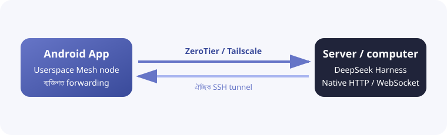

<h1 align="center">DSH Mobile Mesh</h1>

<a href="README.md">English</a> · <a href="README.zh-CN.md">中文</a> · <a href="README.hi.md">हिन्दी</a> · <a href="README.es.md">Español</a> · <a href="README.fr.md">Français</a> · <a href="README.ar.md">العربية</a> · <b>বাংলা</b> · <a href="README.pt.md">Português</a> · <a href="README.ru.md">Русский</a> · <a href="README.ur.md">اردو</a> · <a href="README.th.md">ไทย</a>

## বৈশিষ্ট্য

DSH Mobile Mesh হলো [DeepSeek Harness](https://github.com/deepseek-ai/deepseek-harness)-এর জন্য একটি অনানুষ্ঠানিক Android রিমোট। Agent, Shell, ফাইল এবং workspace DeepSeek Harness চালানো সার্ভারেই থাকে।

- Workspace, session, history এবং live reply দেখুন।
- Tool ফলাফল দেখুন এবং text, image ও file পাঠান।
- Goal, plan, approval, question, job, workflow ও subagent পরিচালনা করুন।
- Model, preset ও skill বদলান এবং DeepSeek Harness slash command চালান।

### Mesh সংযোগ

অ্যাপটি Android-এ বিল্ট-ইনভাবে ZeroTier/libzt অথবা Tailscale/tsnet userspace network চালিয়ে DeepSeek Harness-এর native HTTP/WebSocket interface ফোনে forward করে। DeepSeek Harness-এর launch mode বদলানো বা plugin ইনস্টল করা লাগে না, Android system VPN-ও প্রয়োজন হয় না। Direct, ZeroTier এবং Tailscale—তিনটির উপরই SSH forwarding যোগ করা যায়, ফলে DeepSeek Harness `127.0.0.1`-এ listen করতে পারে।

## ব্যবহার

1. সার্ভারে `dsh web` চালান।
2. ZeroTier বা Tailscale ব্যবহারের আগে DeepSeek Harness চলা সার্ভারে সংশ্লিষ্ট node install ও sign in করুন: [ZeroTier](https://www.zerotier.com/download/) install করে App-এর একই network-এ যোগ দিন, অথবা [Tailscale](https://tailscale.com/docs/install) install করে একই Tailnet-এ sign in করুন।
3. [GitHub Releases](https://github.com/sorsama/deepseek-harness-mobile/releases) থেকে APK নিন।
4. Direct, ZeroTier অথবা Tailscale বেছে নিন; SSH তিনটির জন্যই ঐচ্ছিক layer।
5. চাইলে DeepSeek Harness launch token দিন।

## নিরাপত্তা

DeepSeek Harness host-এ command চালাতে এবং file পড়তে বা লিখতে পারে। সুরক্ষাহীন port public internet-এ প্রকাশ করবেন না এবং token, SSH key ও Mesh identity সুরক্ষিত রাখুন।

## সামঞ্জস্য ও প্রোটোকল বেসলাইন

Android অ্যাপের DTO baseline DeepSeek Harness `v0.2.1-rc.2` (commit `687f282e86`) অনুসরণ করে, যাতে `workspace/follow`-এর সম্পূর্ণ `replace` snapshot, Host-নির্ধারিত `session/create` আইডি এবং 0.2.1 alpha ধারায় যোগ হওয়া acknowledgement-ভিত্তিক `terminal/attach` input রয়েছে। Settings ও connection details panel-এ একই baseline দেখানো হয়। সংযোগের সময় অ্যাপ বিদ্যমান read-only `session/list` ও `session/projections` probe ব্যবহার করে এবং স্বয়ংক্রিয় reconnect-এর জন্য শনাক্ত ক্ষমতা cache করে; সার্ভারের version string দেখে সমর্থন অনুমান করে না। পুরোনো Host-এ projection route না থাকলে অ্যাপ legacy subagent API ব্যবহার করে।

`v0.2.1-rc.2` আপডেট অ্যাপের কোনো endpoint বদলায়নি: account notification field পরিবর্তন `account/getUnnotifiedBonuses`-এ প্রযোজ্য, যা Android client ব্যবহার করে না; terminal client পরিবর্তন হলো অপরিবর্তিত `terminal/list` response-এর ওপর browser-side discovery cache। তাই পুরোনো Host একই probe দিয়েই কাজ করে, এবং অ্যাপের প্রকৃত ব্যবহারপথ ছাড়া কোনো capability দাবি করা হয় না।

গৃহীত 0.2.1 baseline `workspace/follow`-ও কভার করে: পুরোনো `baseline` ও নতুন `replace` উভয়ই workspace, archive এবং pin order সম্পূর্ণ প্রতিস্থাপন করে। `session/list` ও `session/projections` read-only probe অপরিবর্তিত; `session/create.sessionId` ডিফল্টে বাদ যায় এবং ফেরত দেওয়া ID ব্যবহৃত হয়। read-only `terminal/environment.maxBufferedBytes` থাকলে নতুন দ্বিমুখী `terminal/attach` stream ব্যবহৃত হয়; পুরোনো Host-এ এটি না থাকলে `terminal/follow` ও write/resize পথ বহাল থাকে। প্রতি attachment-এ ধারাবাহিক command Host acknowledgement-এর অপেক্ষা করে এবং পাঠানোর আগে transport window সীমা যাচাই করে। `terminal/list`-এর ফলাফল প্রতি session-এ cache করা হয় এবং সেই session-এর সব terminal view শেয়ার করে, প্রতিটি নতুন connection generation-এ একবার পুনরায় লোড হয়; create ও নিশ্চিত close cached row সংশোধন করে, আর terminal metadata-র একমাত্র উৎস Host response থাকে।

অ্যাপ `kind` ছাড়া পুরোনো projection response এবং নতুন `session/projections` response—দুটিই গ্রহণ করে। `migration-required` response-কে sequence-বিহীন hint হিসেবে ধরে, live event watermark-এর সঙ্গে merge করে না। `session/list.formatStatus` ঐচ্ছিক; পুরোনো Host-এর সঙ্গে সামঞ্জস্য রাখতে `session/fork.allowMigration` ডিফল্টে বাদ থাকে। `external` subagent entry-র server-returned metadata দেখানো হয়, তবে সেটিকে Session transcript হিসেবে খোলা যায় না। `terminal/environment.cwd` হলো Host-এ নথিভুক্ত বর্তমান directory।

## রেফারেন্স

- [DeepSeek Harness](https://github.com/deepseek-ai/deepseek-harness)
- [OpenCode Mobile Mesh](https://github.com/chliny/opencode-mobile-mesh)
- [DeepSeek Harness Mobile](https://github.com/sorsama/deepseek-harness-mobile)

## লাইসেন্স

[MIT License](LICENSE)। DeepSeek Harness ও তার branding নিজ নিজ মালিকের সম্পত্তি।
