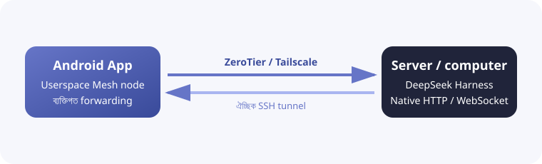

<h1 align="center">DSH Mobile Mesh</h1>

<a href="README.md">English</a> · <a href="README.zh-CN.md">中文</a> · <a href="README.hi.md">हिन्दी</a> · <a href="README.es.md">Español</a> · <a href="README.fr.md">Français</a> · <a href="README.ar.md">العربية</a> · <b>বাংলা</b> · <a href="README.pt.md">Português</a> · <a href="README.ru.md">Русский</a> · <a href="README.ur.md">اردو</a> · <a href="README.th.md">ไทย</a>

## বৈশিষ্ট্য

DSH Mobile Mesh হলো [DeepSeek Harness](https://github.com/deepseek-ai/deepseek-harness)-এর জন্য একটি অনানুষ্ঠানিক Android রিমোট। Agent, Shell, ফাইল এবং workspace DeepSeek Harness চালানো সার্ভারেই থাকে।

- Workspace, session, history এবং live reply দেখুন।
- Tool ফলাফল দেখুন এবং text, image ও file পাঠান।
- Goal, plan, approval, question, job, workflow ও subagent পরিচালনা করুন।
- Model, preset ও skill বদলান এবং DeepSeek Harness slash command চালান।

### Mesh সংযোগ

অ্যাপটি Android-এ বিল্ট-ইনভাবে ZeroTier/libzt অথবা Tailscale/tsnet userspace network চালিয়ে DeepSeek Harness-এর native HTTP/WebSocket interface ফোনে forward করে। DeepSeek Harness-এর launch mode বদলানো বা plugin ইনস্টল করা লাগে না, Android system VPN-ও প্রয়োজন হয় না। Direct, ZeroTier এবং Tailscale—তিনটির উপরই SSH forwarding যোগ করা যায়, ফলে DeepSeek Harness `127.0.0.1`-এ listen করতে পারে।

## ব্যবহার

1. সার্ভারে `dsh web` চালান।
2. ZeroTier বা Tailscale ব্যবহারের আগে DeepSeek Harness চলা সার্ভারে সংশ্লিষ্ট node install ও sign in করুন: [ZeroTier](https://www.zerotier.com/download/) install করে App-এর একই network-এ যোগ দিন, অথবা [Tailscale](https://tailscale.com/docs/install) install করে একই Tailnet-এ sign in করুন।
3. [GitHub Releases](https://github.com/sorsama/deepseek-harness-mobile/releases) থেকে APK নিন।
4. Direct, ZeroTier অথবা Tailscale বেছে নিন; SSH তিনটির জন্যই ঐচ্ছিক layer।
5. চাইলে DeepSeek Harness launch token দিন।

## নিরাপত্তা

DeepSeek Harness host-এ command চালাতে এবং file পড়তে বা লিখতে পারে। সুরক্ষাহীন port public internet-এ প্রকাশ করবেন না এবং token, SSH key ও Mesh identity সুরক্ষিত রাখুন।

## সামঞ্জস্য ও প্রোটোকল বেসলাইন

Android অ্যাপের প্রোটোকল DTO baseline DeepSeek Harness `v0.2.2-rc.1` (commit `66491b05e3`) অনুসরণ করে। wire types upstream `master`-এর `fcc0ad4621`-এর বিরুদ্ধেও যাচাই করা হয়েছে, যা ওই release থেকে 811 commits এগিয়ে এবং নিজে কোনো release নয়; যেখানে ওই শাখা অ্যাপের কল করা কোনো shape ইতিমধ্যে বদলেছে, সেখানে অ্যাপ দুই রূপই রাখে। Settings ও connection details panel-এ দেখানো প্রোটোকল baseline `v0.2.2-rc.1` release রিপোর্ট করে। সংযোগের সময় অ্যাপ বিদ্যমান read-only `session/list` ও `session/projections` probe ব্যবহার করে এবং স্বয়ংক্রিয় reconnect-এর জন্য শনাক্ত ক্ষমতা cache করে; সার্ভারের version string থেকে capability অনুমান করে না। projection route না থাকা Host legacy subagent API দিয়ে চলতে থাকে।

`v0.2.2-rc.1` অ্যাপের আগে থেকে কল করা প্রতিটি route রাখে, কিন্তু তিনটি request shape বদলায়। `session/attachment` এখন শুধু `attachmentId`-র বদলে সম্পূর্ণ `ImageAttachmentRef` নেয়; Android দুই member-ই পাঠায়, এবং দুই প্রজন্মের Host-ই যে request member ঘোষণা করে না তা বাদ দেয়, তাই image পড়তে কোনো capability probe লাগে না। `session/follow` কোনো prepared সাধারণ Session কেবল তখনই resume করে যখন request `activate` সেট করে; Android সবসময় activation চায়, যা নতুন Host-এ 0.2.2-পূর্ব background-promotion আচরণ ফিরিয়ে আনে এবং পুরোনো Host তা বাদ দেয়, আর subagent transcript passive থাকে। `session/control`-এর projection frame একটি committed event-এর জন্য একাধিক key পরিবর্তন বহন করতে পারে; অ্যাপ legacy single-key frame normalize করে এবং দুটিই গ্রহণ করে। সংকুচিত `session/list` projection summary আর `imageLimits`-এর মতো host-wide মান পুনরাবৃত্তি করে না; অ্যাপ সেগুলো `session/projections` ও control baseline থেকে পড়ে এবং অনুপস্থিত summary key-কে কখনো অনুপস্থিত capability হিসেবে ধরে না। Host প্রদত্ত subagent catalog `name` বিদ্যমান `label`-এর সঙ্গে দেখানো হয়; পুরোনো Host এটি না দিলে আগের প্রদর্শন অপরিবর্তিত থাকে। catalog-এর model badge মডেলের নামের পাশে দেখানো হয়, পাঠকের ভাষা না থাকলে Host-এর ইংরেজি টেক্সট ব্যবহার করা হয়, এবং ব্যর্থ plugin এন্ট্রি Host-এর জানানো startup diagnostic দেখায়। বর্তমান Session-এর `agentTeam` projection-এ প্রকাশিত Agent Team টাস্ক বোর্ড বিস্তারিত প্যানেলে Host-এর ক্রমে render হয়, যেখানে Host-এর প্রস্তুতি, লেখার সুযোগের সতর্কতা এবং আপডেট প্রত্যাখ্যাত হওয়ার পর বোর্ড কেবল শেষ বৈধ অবস্থা হলে একটি স্পষ্ট বিজ্ঞপ্তি অন্তর্ভুক্ত থাকে; যে পুরোনো Host-এ এই projection নেই সেটি কোনো বোর্ড দেখায় না।

বিস্তারিত প্যানেল read-only `session/state` ও `session/observeState` stream-এর মাধ্যমে Host-এর নিষ্ক্রিয় Session অবস্থাও দেখায়: active/running ফ্ল্যাগ, অপেক্ষমাণ সারি পড়া যায় কি না ও তাতে কত আইটেম আছে, এবং সর্বশেষ অবস্থা পড়ার সময় নমুনাকৃত pending-input শ্রেণি। ব্যবহারকারীর শুরু করা “সর্বোচ্চ 20 সেকেন্ড অপেক্ষা করুন” একবার `session/wait` কল করে, Host-এর `idle`, `input-required` বা `timeout` কারণ দেখায়, assistant আউটপুট কাটা পড়েছে বলে জানায়, এবং Session কখনো থামায় না; transport স্তরে ব্যর্থ অপেক্ষা ব্যর্থতা হিসেবে দেখানো হয়, কখনো Host timeout হিসেবে নয়। সংশ্লিষ্ট সারফেস কেবল তখনই লুকানো হয় যখন Host তার নিজস্ব endpoint-এর জন্য কাঠামোবদ্ধ missing route উত্তর দেয়, এবং permission বা অসম্পর্কিত ত্রুটি পুরোনো Host হিসেবে ধরে না নিয়ে ত্রুটি হিসেবে দেখানো হয়।

ইতিহাসের pagination ও subagent preview পড়তে অ্যাপ read-only `session/events` অগ্রাধিকার দেয়। কেবল এই route নিজেই অনুপস্থিত হওয়ার প্রমাণেই fallback হয় — stream-এ gateway-এর missing-endpoint error, বা unary call-এ shared handler-এর HTTP 404: pagination-এর জন্য `session/page` এবং subagent preview-এর জন্য `session/follow`-এর প্রথম frame ব্যবহৃত হয়। timeout বা permission error fallback ঘটায় না। ভিন্ন অর্থবিধির কারণে মূল session-এর snapshot ও live state-এর জন্য `session/follow` এবং `session/control` ব্যবহৃত হতে থাকে।

সম্পূর্ণ হওয়া `apply_patch` ফলাফল কেবল সেই hunks দেখায় যেগুলো Host জানায় যে প্রয়োগ করা হয়েছে; প্যাচ আগেই থেমে গেলে কার্ড তা স্পষ্ট করে এবং Host-এর নিজস্ব থেমে যাওয়া অপারেশনের বিবরণ রাখে, আর চলমান কল, ত্রুটি বা অনুপস্থিত metadata-তে সাধারণ ফলাফল টেক্সটই থাকে।

আরও দুটি wire পরিবর্তন প্রতিরক্ষামূলকভাবে সামলানো হয়। upstream `master` কোনো release-এ যুক্ত হওয়ার আগেই `subagents/interruptByParent`-এর নাম এক argument-বিশিষ্ট `subagents/interruptByUser`-এ বদলায়; Host ব্যবহারকারী রূপে উত্তর দিলে অ্যাপ সেটিই ব্যবহার করে এবং কেবল তখনই parent রূপে ফিরে যায় যখন Host জানায় যে ওই route নিজেই অনুপস্থিত, তাই subagent থামানো release করা Host ও বর্তমান `master` build—দুটিতেই কাজ করে। `userQuestions` request নতুন `approval` presentation intent বহন করতে পারে; অ্যাপ ওই variant-কে সাধারণ question card হিসেবে decode করে, এবং ভবিষ্যতের অজানা intent-ও একই সাধারণ flow-এ নেমে আসে, request বাদ পড়ে না।

গৃহীত 0.2.1 baseline `workspace/follow`-ও কভার করে: পুরোনো `baseline` ও নতুন `replace` উভয়ই workspace, archive এবং pin order সম্পূর্ণ প্রতিস্থাপন করে। `session/list` ও `session/projections` read-only probe অপরিবর্তিত; `session/create.sessionId` ডিফল্টে বাদ যায় এবং ফেরত দেওয়া ID ব্যবহৃত হয়। read-only `terminal/environment.maxBufferedBytes` থাকলে নতুন দ্বিমুখী `terminal/attach` stream ব্যবহৃত হয়; পুরোনো Host-এ এটি না থাকলে `terminal/follow` ও write/resize পথ বহাল থাকে। প্রতি attachment-এ ধারাবাহিক command Host acknowledgement-এর অপেক্ষা করে এবং পাঠানোর আগে transport window সীমা যাচাই করে। `terminal/list`-এর ফলাফল প্রতি session-এ cache করা হয় এবং সেই session-এর সব terminal view শেয়ার করে, প্রতিটি নতুন connection generation-এ একবার পুনরায় লোড হয়; create ও নিশ্চিত close cached row সংশোধন করে, আর terminal metadata-র একমাত্র উৎস Host response থাকে।

অ্যাপ `kind` ছাড়া পুরোনো projection response এবং নতুন `session/projections` response—দুটিই গ্রহণ করে। `migration-required` response-কে sequence-বিহীন hint হিসেবে ধরে, live event watermark-এর সঙ্গে merge করে না। `session/list.formatStatus` ঐচ্ছিক; পুরোনো Host-এর সঙ্গে সামঞ্জস্য রাখতে `session/fork.allowMigration` ডিফল্টে বাদ থাকে। `external` subagent entry-র server-returned metadata দেখানো হয়, তবে সেটিকে Session transcript হিসেবে খোলা যায় না। `terminal/environment.cwd` হলো Host-এ নথিভুক্ত বর্তমান directory।

Android কথোপকথন তালিকা এখন Host-পরিচালিত স্বয়ংক্রিয় কাজ খোলে। read-only `schedule/catalog` request উপলব্ধতা যাচাই করে; কেবল missing-route উত্তরই কোনো Host-কে Schedule সমর্থনহীন চিহ্নিত করে। `v0.2.2-rc.1` task mutation `schedule/edit`-এ সরিয়েছে এবং catalog row-এ delivery `target`, `active`/`paused`/`ended` status এবং `updatedAt` revision যোগ করেছে। অ্যাপ আধুনিক edit route চেষ্টা করে এবং কেবল তখনই `schedule/update` ও `schedule/delete`-এ ফিরে যায় যখন Host জানায় যে ওই route নিজেই অনুপস্থিত, এবং ফলাফল connection generation-এর জন্য মনে রাখে: আধুনিক পথ দেখা `updatedAt`-কে `expectedUpdatedAt` হিসেবে পাঠায়, row থেকে target Session খোলে এবং নতুন status দেখায়, আর legacy পথ সম্পূর্ণ দেখা নিয়মকে `expected` হিসেবে রাখে। দুই catalog row shape-ই decode হয়, তাই পুরোনো ও নতুন Host একই তালিকা render করে। Host নতুন ব্যবস্থাপনা route সরবরাহ করলে অ্যাপ সরাসরি `schedule/create` দিয়ে কাজ তৈরি করে — বিদ্যমান Session-এ, প্রথম ডেলিভারিতে তৈরি একটি Session-এ, বা প্রতিটি ডেলিভারিতে নতুন Session-এ — `schedule/edit` দিয়ে সেটি বিরত ও পুনরায় চালু করে, `schedule/run` দিয়ে সময়সূচি না বদলিয়ে একবার চালায়, এবং একটি নিশ্চিত `schedule/deleteInactive` কলে সমাপ্ত কাজগুলো মুছে দেয়; `schedule/deliveryLimits` Host যে ন্যূনতম নতুন-Session বিরতি প্রয়োগ করে তা দেয়। প্রতিটি ব্যর্থতা প্রমাণ থেকে শ্রেণিবদ্ধ করা হয়: missing route কেবল সেই ক্রিয়াটিকে প্রভাবিত করে এবং অসমর্থিত হিসেবে জানানো হয়, Host-এর ব্যবসায়িক প্রত্যাখ্যান Host-এর নিজের বার্তাসহ দেখানো হয়, আর কেবল transport স্তরের ব্যর্থতাই অজানা ফলাফল হিসেবে জানানো হয় যা পুনরায় চেষ্টার আগে পাঠককে রিফ্রেশ করতে হয়। ওই routes অনুপস্থিত থাকলে creation এখনও Web-এর মতো একটি Session শুরু করে এবং reminder তার Agent-কে জিজ্ঞাসা করে তৈরি হয়। Host catalog search/filter API নেই, তাই Android আলাদা client-side search বা status filter বানায় না।

## রেফারেন্স

- [DeepSeek Harness](https://github.com/deepseek-ai/deepseek-harness)
- [OpenCode Mobile Mesh](https://github.com/chliny/opencode-mobile-mesh)
- [DeepSeek Harness Mobile](https://github.com/sorsama/deepseek-harness-mobile)

## লাইসেন্স

[MIT License](LICENSE)। DeepSeek Harness ও তার branding নিজ নিজ মালিকের সম্পত্তি।
