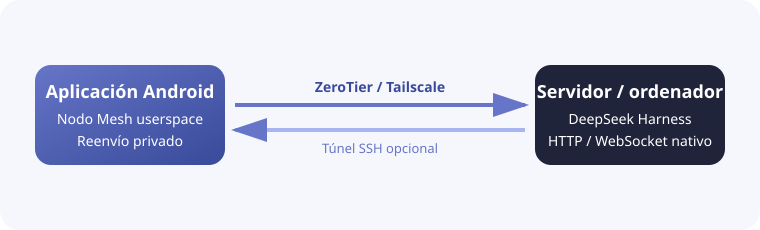

<h1 align="center">DSH Mobile Mesh</h1>

<a href="README.md">English</a> · <a href="README.zh-CN.md">中文</a> · <a href="README.hi.md">हिन्दी</a> · <b>Español</b> · <a href="README.fr.md">Français</a> · <a href="README.ar.md">العربية</a> · <a href="README.bn.md">বাংলা</a> · <a href="README.pt.md">Português</a> · <a href="README.ru.md">Русский</a> · <a href="README.ur.md">اردو</a> · <a href="README.th.md">ไทย</a>

## Características

DSH Mobile Mesh es un control remoto Android no oficial para [DeepSeek Harness](https://github.com/deepseek-ai/deepseek-harness). El Agent, Shell, los archivos y el workspace siguen ejecutándose en el servidor donde está instalado DeepSeek Harness.

- Explorar workspaces, sesiones, historial y respuestas en tiempo real.
- Ver resultados de herramientas y enviar texto, imágenes y archivos.
- Gestionar objetivos, planes, aprobaciones, preguntas, tareas, workflows y subagentes.
- Cambiar modelos, presets y skills, y ejecutar comandos slash de DeepSeek Harness.

### Conexión Mesh

La app incorpora en Android una red userspace de ZeroTier/libzt o Tailscale/tsnet y reenvía al teléfono la interfaz HTTP/WebSocket nativa de DeepSeek Harness. DeepSeek Harness no necesita cambios en su forma de inicio ni plugins, y tampoco se requiere una VPN del sistema Android. SSH puede añadirse sobre Direct, ZeroTier o Tailscale, permitiendo que DeepSeek Harness siga escuchando en `127.0.0.1`.

## Uso

1. Ejecuta `dsh web` en el servidor.
2. Antes de usar ZeroTier o Tailscale, instala e inicia sesión en el nodo correspondiente del servidor donde se ejecuta DeepSeek Harness: instala [ZeroTier](https://www.zerotier.com/download/) y únete a la misma red que la app, o instala [Tailscale](https://tailscale.com/docs/install) e inicia sesión en el mismo Tailnet.
3. Descarga el APK desde [GitHub Releases](https://github.com/sorsama/deepseek-harness-mobile/releases).
4. Elige Direct, ZeroTier o Tailscale; SSH es una capa opcional para los tres.
5. Introduce el launch token de DeepSeek Harness cuando se solicite.

## Seguridad

DeepSeek Harness puede ejecutar comandos y leer o escribir archivos en su host. No expongas un puerto sin protección a Internet y protege tokens, claves SSH y credenciales Mesh.

## Compatibilidad y referencia del protocolo

La referencia de DTO del protocolo de la app Android sigue DeepSeek Harness `v0.2.2-rc.1` (commit `66491b05e3`). Los tipos de datos del protocolo también se comprobaron con el `master` upstream en `fcc0ad4621`, que está 811 commits por delante de esa versión y no es una versión por sí mismo; donde esa rama ya cambió una forma que la app llama, la app conserva ambas formas. La referencia de protocolo mostrada en Ajustes y en el panel de detalles de conexión indica la versión `v0.2.2-rc.1`. Al conectarse, la app usa las sondas de solo lectura existentes `session/list` y `session/projections` y guarda las capacidades observadas para reconexiones automáticas; no deduce capacidades a partir de una cadena de versión del servidor. Los Hosts sin la ruta de projection continúan mediante la API legacy de subagent.

`v0.2.2-rc.1` conserva todas las rutas que esta app ya llamaba, pero cambia tres formas de petición. `session/attachment` ahora toma el `ImageAttachmentRef` completo en lugar de un `attachmentId` aislado; Android envía ambos miembros, y los Hosts de ambas generaciones descartan el miembro de la petición que no declaran, así que la lectura de imágenes no necesita ninguna sonda de capacidad. `session/follow` solo reanuda una Session normal preparada cuando la petición establece `activate`; Android siempre solicita la activación, lo que restaura en los Hosts nuevos el comportamiento de promoción en segundo plano anterior a 0.2.2 y es descartado por los antiguos, mientras que los transcripts de subagent siguen pasivos. Los frames de projection de `session/control` pueden llevar varios cambios de clave para un único evento confirmado; la app normaliza el frame legacy de una sola clave y acepta ambos. El resumen de projection reducido de `session/list` ya no repite valores de todo el Host como `imageLimits`; la app los lee de `session/projections` y de la referencia de control y nunca trata una clave ausente del resumen como una capacidad ausente. El `name` del catálogo de subagent proporcionado por el Host se muestra junto al `label` existente; cuando un Host antiguo no lo proporciona, se mantiene la visualización anterior. Las insignias de modelo del catálogo se muestran junto al nombre del modelo, usando el texto en inglés del Host cuando falta el idioma del lector, y una entrada de plugin fallida muestra el diagnóstico de inicio notificado por el Host. El tablero de tareas de Agent Team publicado en la proyección `agentTeam` de la Session actual se muestra en el panel de detalles en el orden del Host, incluidos la preparación del Host, las advertencias de ámbito de escritura y un aviso destacado cuando el tablero es solo el último estado válido tras un rechazo de actualización; un Host antiguo sin la proyección no muestra ningún tablero.

El panel de detalles también muestra el estado pasivo de la Session del Host mediante `session/state` y el flujo `session/observeState`, ambos de solo lectura: indicadores de active/running, si la cola pendiente se puede leer y cuántos elementos contiene, y las categorías de entrada pendiente muestreadas en la última lectura de estado. La acción iniciada por el usuario “Esperar hasta 20 segundos” llama una vez a `session/wait`, informa del motivo `idle`, `input-required` o `timeout` del Host, avisa de la salida truncada del asistente y nunca detiene la Session; una espera que falla en el nivel de transporte se informa como fallo, nunca como un timeout del Host. La superficie afectada solo se oculta cuando el Host responde con una ruta ausente estructurada para su propio endpoint, y los errores de permiso o no relacionados se muestran como errores en lugar de tratarse como un Host antiguo.

Para paginar el historial y obtener vistas previas de subagentes, la app prefiere `session/events` de solo lectura. Solo la evidencia de que esa ruta misma está ausente activa el recurso alternativo — el error de endpoint ausente del gateway en un stream, o el HTTP 404 del manejador compartido en una llamada unaria: usa `session/page` para la paginación y el primer frame de `session/follow` para las vistas previas. Los tiempos de espera y los errores de permisos no provocan ese recurso. Debido a sus distintas semánticas, `session/follow` y `session/control` siguen usándose para la instantánea y el estado en vivo de la sesión principal.

Un resultado `apply_patch` completado muestra solo los hunks que el Host informa haber aplicado; cuando el parche se detuvo antes de tiempo, la tarjeta lo indica y conserva el detalle propio del Host sobre la operación detenida, mientras que una llamada en curso, un error o la ausencia de metadatos mantienen el texto de resultado genérico.

Dos cambios de cable adicionales se manejan de forma defensiva. El `master` upstream renombró `subagents/interruptByParent` a `subagents/interruptByUser` con un solo argumento antes de que ninguna versión lo incluyera; la app usa la forma de usuario cuando un Host responde a ella y solo vuelve a la forma parent cuando el Host informa de que esa ruta misma está ausente, de modo que detener un subagent funciona tanto en Hosts publicados como en compilaciones actuales de `master`. Una petición `userQuestions` puede llevar un nuevo intent de presentación `approval`; la app decodifica esa variante como una tarjeta de pregunta genérica, y un intent futuro desconocido se degrada al mismo flujo genérico en lugar de descartar la petición.

La referencia 0.2.1 adoptada también cubre `workspace/follow`: tanto el antiguo `baseline` como el nuevo `replace` sustituyen por completo espacios, archivos y orden de favoritos. Se conservan las sondas de solo lectura `session/list` y `session/projections`; `session/create.sessionId` se omite por defecto y se usa el ID devuelto. El campo de solo lectura `terminal/environment.maxBufferedBytes` selecciona el flujo bidireccional `terminal/attach`; si falta en un Host antiguo, se conservan `terminal/follow` y las rutas write/resize. Los comandos se numeran por conexión y esperan el acuse del Host antes del siguiente envío, respetando el límite de la ventana de transporte. El descubrimiento de `terminal/list` se almacena por sesión y lo comparten todas las vistas de terminal de esa sesión; se vuelve a cargar una vez por cada nueva generación de conexión, y la creación y el cierre confirmado ajustan las filas almacenadas, mientras que la respuesta del Host sigue siendo la única fuente de metadatos del terminal.

Los resultados Remote que transportan bytes nativos llegan como `multipart/form-data`: una parte `metadata` contiene el sobre server-response habitual con cada campo de bytes en `null`, y las partes binarias se vuelven a insertar en esos campos antes de decodificar. Las lecturas de bytes del workspace —y por tanto las imágenes del workspace que la app muestra dentro de los mensajes Markdown— usan esa ruta, así que siguen funcionando con Hosts de Harness 0.2.0 en adelante; un Host que aún responda con un array de bytes JSON o una cadena base64 se decodifica como antes.

La app acepta tanto respuestas antiguas de projections sin `kind` como las variantes actuales de `session/projections`. `migration-required` se trata como una indicación sin secuencia y no se combina con marcas de agua de eventos en vivo. `session/list.formatStatus` es opcional y `session/fork.allowMigration` se omite por defecto para mantener la compatibilidad con Hosts antiguos. Las entradas de subagent con modo `external` se muestran con los datos del servidor, pero no se abren como transcript de una Session. `terminal/environment.cwd` representa el directorio actual registrado por el Host.

La lista de conversaciones de Android ahora abre tareas automáticas propiedad del Host. Una petición de solo lectura `schedule/catalog` comprueba la disponibilidad; solo una respuesta de ruta ausente marca un Host sin soporte de Schedule. `v0.2.2-rc.1` trasladó la mutación de tareas a `schedule/edit` e hizo que las filas del catálogo lleven un `target` de entrega, un estado `active`/`paused`/`ended` y una revisión `updatedAt`. La app intenta la ruta de edición moderna y solo recurre a `schedule/update` y `schedule/delete` cuando el Host informa de que esa ruta misma está ausente, recordando el resultado para la generación de conexión: la ruta moderna envía el `updatedAt` observado como `expectedUpdatedAt`, abre la Session de destino desde la fila y muestra los estados nuevos, mientras que la ruta legacy conserva la regla completa observada como `expected`. Ambas formas de fila del catálogo se decodifican, así que los Hosts antiguos y nuevos muestran la misma lista. Cuando el Host expone las nuevas rutas de gestión, la app crea una tarea directamente con `schedule/create` —con entrega a una Session existente, a una Session creada en la primera entrega o a una Session nueva por entrega—, la pausa y la reanuda mediante `schedule/edit`, ejecuta una ocurrencia con `schedule/run` sin mover la programación y elimina las tareas finalizadas en una sola llamada confirmada a `schedule/deleteInactive`; `schedule/deliveryLimits` proporciona el intervalo mínimo para Sessions nuevas que aplica el Host. Cada fallo se clasifica a partir de la evidencia: una ruta ausente afecta solo a esa acción y se informa como no admitida, un rechazo de negocio del Host se muestra con el mensaje propio del Host, y solo los fallos de nivel de transporte se informan como un resultado desconocido que el lector debe actualizar antes de reintentar. Cuando esas rutas no existen, la creación sigue iniciando una Session como en la Web y los recordatorios se crean pidiéndoselos a su Agent. Las API de búsqueda/filtrado del catálogo del Host no están disponibles, así que Android no inventa una búsqueda ni un filtro de estado locales separados.

## Referencias

- [DeepSeek Harness](https://github.com/deepseek-ai/deepseek-harness)
- [OpenCode Mobile Mesh](https://github.com/chliny/opencode-mobile-mesh)
- [DeepSeek Harness Mobile](https://github.com/sorsama/deepseek-harness-mobile)

## Licencia

[MIT License](LICENSE). DeepSeek Harness y su marca pertenecen a sus respectivos propietarios.
