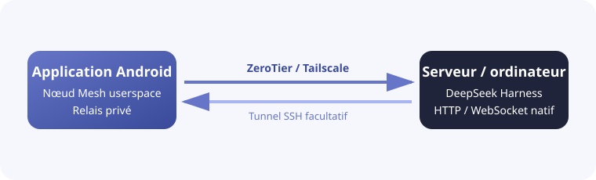

<h1 align="center">DSH Mobile Mesh</h1>

<a href="README.md">English</a> · <a href="README.zh-CN.md">中文</a> · <a href="README.hi.md">हिन्दी</a> · <a href="README.es.md">Español</a> · <b>Français</b> · <a href="README.ar.md">العربية</a> · <a href="README.bn.md">বাংলা</a> · <a href="README.pt.md">Português</a> · <a href="README.ru.md">Русский</a> · <a href="README.ur.md">اردو</a> · <a href="README.th.md">ไทย</a>

## Fonctionnalités

DSH Mobile Mesh est un client Android non officiel pour [DeepSeek Harness](https://github.com/deepseek-ai/deepseek-harness). L’Agent, le Shell, les fichiers et le workspace restent sur le serveur où DeepSeek Harness est installé.

- Parcourir les workspaces, sessions, historiques et réponses en continu.
- Consulter les outils et envoyer du texte, des images ou des fichiers.
- Gérer objectifs, plans, validations, questions, tâches, workflows et sous-agents.
- Changer de modèle, de preset et de skill, et lancer les commandes slash de DeepSeek Harness.

### Connexion Mesh

L’application intègre sur Android un réseau userspace ZeroTier/libzt ou Tailscale/tsnet et relaie vers le téléphone l’interface HTTP/WebSocket native de DeepSeek Harness. DeepSeek Harness n’a besoin d’aucune modification de son mode de lancement ni d’aucun plugin, et aucun VPN système Android n’est requis. SSH peut s’ajouter à Direct, ZeroTier ou Tailscale, afin que DeepSeek Harness continue d’écouter sur `127.0.0.1`.

## Utilisation

1. Lancez `dsh web` sur le serveur.
2. Avant d’utiliser ZeroTier ou Tailscale, installez et connectez le nœud correspondant sur le serveur où DeepSeek Harness s’exécute : installez [ZeroTier](https://www.zerotier.com/download/) et rejoignez le même réseau que l’application, ou installez [Tailscale](https://tailscale.com/docs/install) et connectez-vous au même Tailnet.
3. Téléchargez l’APK depuis [GitHub Releases](https://github.com/sorsama/deepseek-harness-mobile/releases).
4. Choisissez Direct, ZeroTier ou Tailscale ; SSH est une couche optionnelle pour les trois.
5. Saisissez le launch token de DeepSeek Harness si demandé.

## Sécurité

DeepSeek Harness peut exécuter des commandes et lire ou écrire des fichiers sur son hôte. N’exposez pas un port non protégé sur Internet et protégez tokens, clés SSH et identifiants Mesh.

## Compatibilité et référence du protocole

La référence DTO du protocole de l’application Android suit DeepSeek Harness `v0.2.2-rc.1` (commit `66491b05e3`). Les types de données du protocole ont aussi été vérifiés par rapport au `master` amont à `fcc0ad4621`, qui se trouve 811 commits après cette version et n’est pas lui-même une version publiée ; là où cette branche a déjà modifié une forme appelée par l’application, celle-ci conserve les deux formes. La référence de protocole affichée dans les réglages et le panneau de détails de connexion indique la version `v0.2.2-rc.1`. À la connexion, l’application utilise les sondes existantes en lecture seule `session/list` et `session/projections` et mémorise les capacités observées pour les reconnexions automatiques ; elle ne déduit pas les capacités d’une chaîne de version du serveur. Les Hosts dépourvus de route projection continuent via l’ancienne API subagent.

`v0.2.2-rc.1` conserve toutes les routes déjà appelées par cette application, mais modifie trois formes de requête. `session/attachment` prend désormais l’`ImageAttachmentRef` complet au lieu d’un simple `attachmentId` ; Android envoie les deux membres, et les Hosts des deux générations ignorent le membre de requête qu’ils ne déclarent pas, si bien que la lecture d’images ne nécessite aucune sonde de capacité. `session/follow` ne reprend une Session ordinaire préparée que si la requête définit `activate` ; Android demande toujours l’activation, ce qui restaure sur les nouveaux Hosts le comportement de promotion en arrière-plan antérieur à 0.2.2 et est ignoré par les anciens, tandis que les transcripts de subagent restent passifs. Les frames projection de `session/control` peuvent porter plusieurs changements de clé pour un seul événement validé ; l’application normalise la frame legacy à clé unique et accepte les deux. Le résumé projection restreint de `session/list` ne répète plus les valeurs communes à tout le Host telles que `imageLimits` ; l’application les lit depuis `session/projections` et la référence de contrôle et ne traite jamais une clé absente du résumé comme une capacité absente. Le `name` du catalogue subagent fourni par le Host est affiché aux côtés du `label` existant ; lorsqu’un ancien Host ne le fournit pas, l’affichage reste inchangé. Les badges de modèle du catalogue sont affichés à côté du nom du modèle, en utilisant le texte anglais du Host lorsque la langue du lecteur est absente, et une entrée de plugin en échec affiche le diagnostic de démarrage rapporté par le Host. Le tableau des tâches Agent Team publié dans la projection `agentTeam` de la Session courante est rendu dans le panneau de détails dans l’ordre du Host, y compris l’état de préparation du Host, les avertissements de portée d’écriture et un avis bien visible lorsque le tableau n’est que le dernier état valide après le rejet d’une mise à jour ; un ancien Host sans la projection n’affiche aucun tableau.

Le panneau de détails expose aussi l’état passif de la Session du Host via `session/state` et le flux `session/observeState`, tous deux en lecture seule : indicateurs active/running, si la file d’attente en attente est lisible et combien d’éléments elle contient, et les catégories d’entrée en attente échantillonnées lors de la dernière lecture d’état. L’action lancée par l’utilisateur « Attendre jusqu’à 20 secondes » appelle `session/wait` une seule fois, indique la raison `idle`, `input-required` ou `timeout` du Host, signale la sortie tronquée de l’assistant et n’arrête jamais la Session ; une attente qui échoue au niveau du transport est signalée comme un échec, jamais comme un timeout du Host. La surface concernée n’est masquée que lorsque le Host répond par une route absente structurée pour son propre endpoint, et les erreurs de permission ou sans rapport sont affichées comme des erreurs plutôt que traitées comme un ancien Host.

Pour la pagination de l’historique et les aperçus de sous-agents, l’application privilégie `session/events` en lecture seule. Elle ne recourt aux alternatives que si l’absence de cette route elle-même est prouvée — l’erreur d’endpoint absent renvoyée par la passerelle sur un flux, ou le HTTP 404 du gestionnaire partagé sur un appel unaire : `session/page` pour la pagination et la première frame de `session/follow` pour les aperçus. Les délais d’attente et les erreurs de permission ne déclenchent pas ce repli. En raison de leurs sémantiques différentes, `session/follow` et `session/control` restent utilisés pour l’instantané et l’état en direct de la session principale.

Un résultat `apply_patch` terminé n’affiche que les hunks que le Host déclare avoir appliqués ; lorsque le patch s’est arrêté prématurément, la carte l’indique et conserve le détail propre au Host sur l’opération interrompue, tandis qu’un appel en cours, une erreur ou des métadonnées absentes conservent le texte de résultat générique.

Deux autres changements de câblage sont traités de manière défensive. Le `master` amont a renommé `subagents/interruptByParent` en `subagents/interruptByUser` avec un seul argument avant qu’aucune version ne l’embarque ; l’application utilise la forme utilisateur lorsqu’un Host y répond et ne revient à la forme parent que lorsque le Host signale que cette route elle-même est absente, si bien que l’arrêt d’un subagent fonctionne aussi bien sur les Hosts publiés que sur les builds actuels de `master`. Une requête `userQuestions` peut porter un nouvel intent de présentation `approval` ; l’application décode cette variante comme une carte de question générique, et un futur intent inconnu se dégrade vers le même flux générique au lieu de supprimer la requête.

La référence 0.2.1 adoptée couvre aussi `workspace/follow` : l’ancien `baseline` et le nouveau `replace` remplacent entièrement les espaces, archives et épingles. Les sondes en lecture seule `session/list` et `session/projections` restent en place ; `session/create.sessionId` est omis par défaut et l’identifiant renvoyé est utilisé. Le champ en lecture seule `terminal/environment.maxBufferedBytes` sélectionne le flux bidirectionnel `terminal/attach` ; en son absence, les anciens chemins `terminal/follow` et write/resize sont conservés. Les commandes numérotées par attachement attendent un accusé du Host avant l’envoi suivant et respectent la limite de la fenêtre de transport. La découverte `terminal/list` est mise en cache par Session et partagée par toutes les vues de terminal de cette Session ; elle est rechargée une fois par nouvelle génération de connexion, la création et la fermeture confirmée ajustent les lignes en cache, et la réponse du Host reste la seule source des métadonnées du terminal.

Les résultats Remote qui transportent des octets natifs arrivent en `multipart/form-data` : une partie `metadata` contient l’enveloppe server-response habituelle avec chaque champ d’octets laissé à `null`, et les parties binaires sont réinsérées dans ces champs avant le décodage. Les lectures d’octets du workspace — et donc les images du workspace que l’application affiche dans les messages Markdown — empruntent cette voie, si bien qu’elles continuent de fonctionner avec les Hosts à partir de Harness 0.2.0 ; un Host qui répond encore par un tableau d’octets JSON ou une chaîne base64 se décode comme avant.

L’application accepte les anciennes réponses projection sans `kind` et les variantes actuelles de `session/projections`. Une réponse `migration-required` reste un indice sans séquence et n’est pas fusionnée avec les compteurs des événements en direct. `session/list.formatStatus` est facultatif et `session/fork.allowMigration` est omis par défaut pour préserver la compatibilité avec les anciens Hosts. Les entrées subagent en mode `external` sont affichées avec les métadonnées du serveur, sans être ouvertes comme transcript de Session. `terminal/environment.cwd` désigne le répertoire courant enregistré par le Host.

La liste des conversations Android ouvre désormais les tâches automatisées détenues par le Host. Une requête `schedule/catalog` en lecture seule vérifie la disponibilité ; seule une réponse de route absente signale un Host sans prise en charge de Schedule. `v0.2.2-rc.1` a déplacé la mutation des tâches vers `schedule/edit` et fait porter aux lignes du catalogue un `target` de livraison, un statut `active`/`paused`/`ended` et une révision `updatedAt`. L’application tente la route d’édition moderne et ne retombe sur `schedule/update` et `schedule/delete` que lorsque le Host signale que cette route elle-même est absente, en mémorisant le résultat pour la génération de connexion : le chemin moderne envoie l’`updatedAt` observé comme `expectedUpdatedAt`, ouvre la Session cible depuis la ligne et affiche les nouveaux statuts, tandis que le chemin legacy conserve la règle complète observée comme `expected`. Les deux formes de ligne du catalogue se décodent, si bien que les Hosts anciens et nouveaux affichent la même liste. Lorsque le Host expose les nouvelles routes de gestion, l’application crée une tâche directement avec `schedule/create` — livraison vers une Session existante, une Session créée à la première livraison ou une nouvelle Session à chaque livraison —, la met en pause et la reprend via `schedule/edit`, exécute une occurrence avec `schedule/run` sans déplacer la planification, et supprime les tâches terminées en un seul appel confirmé à `schedule/deleteInactive` ; `schedule/deliveryLimits` fournit l’intervalle minimal pour les nouvelles Sessions que le Host applique. Chaque échec est classé d’après les preuves : une route absente n’affecte que cette action et est signalée comme non prise en charge, un rejet métier du Host est affiché avec le message propre du Host, et seuls les échecs au niveau du transport sont signalés comme un résultat inconnu que le lecteur doit actualiser avant de réessayer. Lorsque ces routes sont absentes, la création démarre toujours une Session comme sur le Web et les rappels sont créés en les demandant à son Agent. Les API de recherche/filtre du catalogue Host ne sont pas disponibles, donc Android n’invente pas de recherche ni de filtre de statut locaux séparés.

## Références

- [DeepSeek Harness](https://github.com/deepseek-ai/deepseek-harness)
- [OpenCode Mobile Mesh](https://github.com/chliny/opencode-mobile-mesh)
- [DeepSeek Harness Mobile](https://github.com/sorsama/deepseek-harness-mobile)

## Licence

[MIT License](LICENSE). DeepSeek Harness et sa marque appartiennent à leurs propriétaires respectifs.
