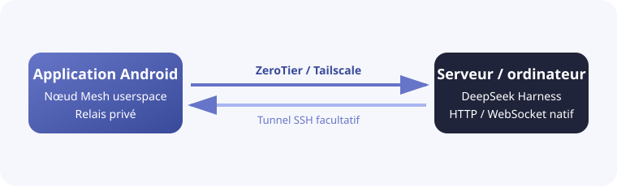

<h1 align="center">DSH Mobile Mesh</h1>

<a href="README.md">English</a> · <a href="README.zh-CN.md">中文</a> · <a href="README.hi.md">हिन्दी</a> · <a href="README.es.md">Español</a> · <b>Français</b> · <a href="README.ar.md">العربية</a> · <a href="README.bn.md">বাংলা</a> · <a href="README.pt.md">Português</a> · <a href="README.ru.md">Русский</a> · <a href="README.ur.md">اردو</a> · <a href="README.th.md">ไทย</a>

## Fonctionnalités

DSH Mobile Mesh est un client Android non officiel pour [DeepSeek Harness](https://github.com/deepseek-ai/deepseek-harness). L’Agent, le Shell, les fichiers et le workspace restent sur le serveur où DeepSeek Harness est installé.

- Parcourir les workspaces, sessions, historiques et réponses en continu.
- Consulter les outils et envoyer du texte, des images ou des fichiers.
- Gérer objectifs, plans, validations, questions, tâches, workflows et sous-agents.
- Changer de modèle, de preset et de skill, et lancer les commandes slash de DeepSeek Harness.

### Connexion Mesh

L’application intègre sur Android un réseau userspace ZeroTier/libzt ou Tailscale/tsnet et relaie vers le téléphone l’interface HTTP/WebSocket native de DeepSeek Harness. DeepSeek Harness n’a besoin d’aucune modification de son mode de lancement ni d’aucun plugin, et aucun VPN système Android n’est requis. SSH peut s’ajouter à Direct, ZeroTier ou Tailscale, afin que DeepSeek Harness continue d’écouter sur `127.0.0.1`.

## Utilisation

1. Lancez `dsh web` sur le serveur.
2. Avant d’utiliser ZeroTier ou Tailscale, installez et connectez le nœud correspondant sur le serveur où DeepSeek Harness s’exécute : installez [ZeroTier](https://www.zerotier.com/download/) et rejoignez le même réseau que l’application, ou installez [Tailscale](https://tailscale.com/docs/install) et connectez-vous au même Tailnet.
3. Téléchargez l’APK depuis [GitHub Releases](https://github.com/sorsama/deepseek-harness-mobile/releases).
4. Choisissez Direct, ZeroTier ou Tailscale ; SSH est une couche optionnelle pour les trois.
5. Saisissez le launch token de DeepSeek Harness si demandé.

## Sécurité

DeepSeek Harness peut exécuter des commandes et lire ou écrire des fichiers sur son hôte. N’exposez pas un port non protégé sur Internet et protégez tokens, clés SSH et identifiants Mesh.

## Compatibilité et référence du protocole

La référence DTO Android suit les contrats session et terminal de DeepSeek Harness `v0.2.1-alpha.2`. À la connexion, l’application utilise les sondes existantes en lecture seule `session/list` et `session/projections`, puis mémorise les capacités détectées pour les reconnexions ; elle ne déduit pas les capacités du numéro de version. Si un ancien Host ne propose pas la route projection, l’application conserve l’ancienne API subagent.

L’application accepte les anciennes réponses projection sans `kind` et les variantes actuelles de `session/projections`. Une réponse `migration-required` reste un indice sans séquence et n’est pas fusionnée avec les compteurs des événements en direct. `session/list.formatStatus` est facultatif et `session/fork.allowMigration` est omis par défaut pour préserver la compatibilité avec les anciens Hosts. Les entrées subagent en mode `external` sont affichées avec les métadonnées du serveur, sans être ouvertes comme transcript de Session. `terminal/environment.cwd` désigne le répertoire courant enregistré par le Host.

## Références

- [DeepSeek Harness](https://github.com/deepseek-ai/deepseek-harness)
- [OpenCode Mobile Mesh](https://github.com/chliny/opencode-mobile-mesh)
- [DeepSeek Harness Mobile](https://github.com/sorsama/deepseek-harness-mobile)

## Licence

[MIT License](LICENSE). DeepSeek Harness et sa marque appartiennent à leurs propriétaires respectifs.
