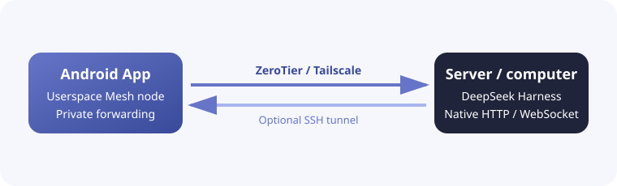

<h1 align="center">DSH Mobile Mesh</h1>

<a href="README.md">English</a> · <a href="README.zh-CN.md">中文</a> · <b>हिन्दी</b> · <a href="README.es.md">Español</a> · <a href="README.fr.md">Français</a> · <a href="README.ar.md">العربية</a> · <a href="README.bn.md">বাংলা</a> · <a href="README.pt.md">Português</a> · <a href="README.ru.md">Русский</a> · <a href="README.ur.md">اردو</a> · <a href="README.th.md">ไทย</a>

## सुविधाएँ

DSH Mobile Mesh, [DeepSeek Harness](https://github.com/deepseek-ai/deepseek-harness) के लिए एक अनौपचारिक Android रिमोट है। Agent, Shell, फ़ाइलें और workspace उसी सर्वर पर चलते हैं जहाँ DeepSeek Harness स्थापित है।

- Workspace, sessions, इतिहास और live replies देखें।
- Tool परिणाम देखें और text, images या files भेजें।
- Goals, plans, approvals, questions, jobs, workflows और subagents संभालें।
- Models, presets और skills बदलें तथा DeepSeek Harness slash commands चलाएँ।

### Mesh कनेक्शन

App Android में ZeroTier/libzt या Tailscale/tsnet userspace नेटवर्क अंतर्निर्मित रूप से चलाता है और DeepSeek Harness के native HTTP/WebSocket interface को फोन तक forward करता है। DeepSeek Harness के launch mode में बदलाव या plugin की आवश्यकता नहीं है और Android system VPN भी आवश्यक नहीं है। Direct, ZeroTier और Tailscale तीनों पर SSH forwarding जोड़ी जा सकती है, जिससे DeepSeek Harness `127.0.0.1` पर सुनता रह सकता है।

## उपयोग

1. सर्वर पर `dsh web` चलाएँ।
2. ZeroTier या Tailscale उपयोग करने से पहले DeepSeek Harness वाले सर्वर पर संबंधित node install और sign in करें: [ZeroTier](https://www.zerotier.com/download/) को install करके App वाले network से जुड़ें, या [Tailscale](https://tailscale.com/docs/install) install करके उसी Tailnet में sign in करें।
3. नवीनतम APK [GitHub Releases](https://github.com/sorsama/deepseek-harness-mobile/releases) से डाउनलोड करें।
4. Direct, ZeroTier या Tailscale चुनें; SSH इन तीनों के ऊपर वैकल्पिक layer है।
5. App के निर्देश पर DeepSeek Harness launch token भरें।

## सुरक्षा

DeepSeek Harness host पर commands चला और files पढ़/लिख सकता है। Unprotected port को public internet पर न रखें और token, SSH keys तथा Mesh identity सुरक्षित रखें।

## संगतता और प्रोटोकॉल baseline

Android ऐप का प्रोटोकॉल DTO baseline DeepSeek Harness `v0.2.2-rc.1` (commit `66491b05e3`) पर आधारित है। wire types की जाँच upstream `master` के `fcc0ad4621` के विरुद्ध भी की गई है, जो उस रिलीज़ से 811 commits आगे है और स्वयं कोई रिलीज़ नहीं है; जहाँ उस शाखा ने ऐप द्वारा कॉल किए जाने वाले किसी shape को पहले ही बदल दिया है, वहाँ ऐप दोनों रूप बनाए रखता है। Settings और connection details panel में दिखाया गया प्रोटोकॉल baseline `v0.2.2-rc.1` रिलीज़ की रिपोर्ट करता है। कनेक्शन पर ऐप मौजूदा read-only `session/list` और `session/projections` probes का उपयोग करता है और automatic reconnect के लिए पहचानी गई capabilities cache करता है; यह server version string से capabilities का अनुमान नहीं लगाता। projection route न रखने वाले Host legacy subagent API के माध्यम से जारी रहते हैं।

`v0.2.2-rc.1` ऐप द्वारा पहले से कॉल किए जाने वाले हर route को बनाए रखता है, लेकिन तीन request shapes बदलता है। `session/attachment` अब केवल `attachmentId` के बजाय पूरा `ImageAttachmentRef` लेता है; Android दोनों members भेजता है, और दोनों पीढ़ियों के Host अपने द्वारा घोषित न किए गए request member को छोड़ देते हैं, इसलिए image reads के लिए किसी capability probe की आवश्यकता नहीं है। `session/follow` किसी prepared सामान्य Session को केवल तभी resume करता है जब request में `activate` सेट हो; Android हमेशा activation मांगता है, जिससे नए Host पर 0.2.2 से पहले का background-promotion व्यवहार बहाल होता है और पुराने Host इसे छोड़ देते हैं, जबकि subagent transcripts passive रहते हैं। `session/control` के projection frames एक committed event के लिए कई key परिवर्तन ले सकते हैं; ऐप legacy single-key frame को normalize करता है और दोनों स्वीकार करता है। संकुचित `session/list` projection summary अब `imageLimits` जैसे host-wide मानों को दोहराता नहीं है; ऐप उन्हें `session/projections` और control baseline से पढ़ता है और कभी भी missing summary key को missing capability नहीं मानता। Host द्वारा दिया गया subagent catalog `name` मौजूदा `label` के साथ दिखाया जाता है; जब पुराना Host इसे नहीं देता, तो पहले जैसा प्रदर्शन बना रहता है। catalog के model badges मॉडल नाम के बगल में दिखाए जाते हैं, और जब पाठक की भाषा उपलब्ध न हो तो Host का अंग्रेज़ी टेक्स्ट उपयोग होता है; विफल plugin प्रविष्टि Host द्वारा रिपोर्ट किया गया startup diagnostic दिखाती है। वर्तमान Session के `agentTeam` projection में प्रकाशित Agent Team कार्य बोर्ड विवरण पैनल में Host के क्रम में render होता है, जिसमें Host की तैयारी, लेखन-स्कोप चेतावनियाँ, और जब किसी अस्वीकृत अपडेट के बाद बोर्ड केवल अंतिम वैध स्थिति हो तो एक प्रमुख सूचना शामिल है; जिस पुराने Host में यह projection नहीं है, वह कोई बोर्ड नहीं दिखाता।

विवरण पैनल read-only `session/state` और `session/observeState` स्ट्रीम के माध्यम से Host की निष्क्रिय Session स्थिति भी दिखाता है: active/running फ़्लैग, क्या पेंडिंग कतार पढ़ने योग्य है और उसमें कितने आइटम हैं, तथा अंतिम बार स्थिति पढ़े जाने पर सैंपल की गई pending-input श्रेणियाँ। उपयोगकर्ता द्वारा शुरू किया गया “अधिकतम 20 सेकंड प्रतीक्षा करें” एक बार `session/wait` कॉल करता है, Host का `idle`, `input-required` या `timeout` कारण दिखाता है, काटे गए assistant आउटपुट का संकेत देता है, और Session को कभी नहीं रोकता; transport स्तर पर विफल प्रतीक्षा को विफलता के रूप में दिखाया जाता है, कभी Host timeout के रूप में नहीं। प्रभावित सतह केवल तभी छिपती है जब Host अपने संबंधित endpoint के लिए संरचित missing route का उत्तर देता है, और permission या असंबंधित त्रुटियाँ पुराने Host के रूप में मानने के बजाय त्रुटियों के रूप में दिखाई जाती हैं।

इतिहास की pagination और subagent preview पढ़ने के लिए ऐप read-only `session/events` को प्राथमिकता देता है। केवल इस route के स्वयं अनुपस्थित होने का प्रमाण fallback शुरू करता है — stream पर gateway का missing-endpoint error, या unary call पर shared handler का HTTP 404: pagination के लिए `session/page` और subagent preview के लिए `session/follow` का पहला frame उपयोग होता है। timeout और permission errors fallback नहीं कराते। अलग semantics के कारण मुख्य session के snapshot और live state के लिए `session/follow` और `session/control` का उपयोग जारी रहता है।

पूर्ण हुआ `apply_patch` परिणाम केवल वे hunks दिखाता है जिन्हें Host बताता है कि लागू किए गए; जब patch समय से पहले रुक गया हो तो कार्ड यह स्पष्ट करता है और Host का अपना रुकी हुई कार्रवाई वाला विवरण रखता है, जबकि चल रही कॉल, त्रुटि या अनुपस्थित metadata पर सामान्य परिणाम टेक्स्ट ही रहता है।

दो और wire परिवर्तन रक्षात्मक रूप से संभाले जाते हैं। upstream `master` ने किसी भी रिलीज़ में शामिल होने से पहले `subagents/interruptByParent` का नाम बदलकर एक argument वाला `subagents/interruptByUser` कर दिया; जब Host उपयोगकर्ता रूप का उत्तर देता है तो ऐप उसी का उपयोग करता है और केवल तभी parent रूप पर लौटता है जब Host स्पष्ट रूप से बताता है कि वह route मौजूद नहीं है, इसलिए subagent रोकना जारी किए गए Host और वर्तमान `master` builds दोनों पर काम करता है। `userQuestions` request में नया `approval` presentation intent हो सकता है; ऐप उस variant को सामान्य question card के रूप में decode करता है, और भविष्य का अज्ञात intent भी उसी सामान्य flow में घट जाता है, request छोड़ी नहीं जाती।

अपनाया गया 0.2.1 baseline `workspace/follow` भी शामिल करता है: पुराना `baseline` और नया `replace` दोनों workspace, archive और pin क्रम को पूरी तरह बदलते हैं। read-only `session/list` और `session/projections` probes बने रहते हैं; `session/create.sessionId` default में छोड़ा जाता है और लौटाई गई ID इस्तेमाल होती है। read-only `terminal/environment.maxBufferedBytes` फ़ील्ड नए द्विदिश `terminal/attach` stream को चुनती है; पुराने Host में इसके न होने पर `terminal/follow` और write/resize मार्ग बने रहते हैं। हर attachment में क्रमांकित command अगला भेजने से पहले Host acknowledgement की प्रतीक्षा करती है और transport window सीमा जाँचती है। `terminal/list` का परिणाम प्रति Session cache होता है और उस Session के सभी terminal views उसे साझा करते हैं; हर नई connection generation पर इसे एक बार फिर लोड किया जाता है, create और पुष्ट close cached rows को सुधारते हैं, और terminal metadata का एकमात्र स्रोत Host response ही रहता है।

मूल बाइट्स ले जाने वाले Remote परिणाम `multipart/form-data` के रूप में आते हैं: `metadata` भाग सामान्य server-response envelope रखता है जिसमें प्रत्येक byte फ़ील्ड `null` छोड़ा जाता है, और शेष बाइनरी भागों को डिकोड करने से पहले उन फ़ील्ड में वापस जोड़ा जाता है। workspace byte reads — और इसलिए ऐप Markdown संदेशों के भीतर जो workspace चित्र दिखाता है — इसी पथ का उपयोग करते हैं, इसलिए वे Harness 0.2.0 और उसके बाद के Host पर भी काम करते रहते हैं; जो Host अब भी JSON byte array या base64 string के साथ उत्तर देता है, वह पहले की तरह डिकोड होता है।

ऐप बिना `kind` वाली legacy projection response और नए `session/projections` response variants दोनों स्वीकार करता है। `migration-required` को बिना sequence वाला hint माना जाता है और इसे live event watermarks के साथ merge नहीं किया जाता। `session/list.formatStatus` optional है; पुराने Host compatibility के लिए `session/fork.allowMigration` default में omit होता है। `external` mode वाले subagent records server की दी हुई metadata के साथ दिखते हैं, लेकिन Session transcript के रूप में नहीं खुलते। `terminal/environment.cwd` Host द्वारा दर्ज मौजूदा directory है।

Android की बातचीत सूची अब Host-प्रबंधित स्वचालित कार्य खोलती है। read-only `schedule/catalog` request उपलब्धता जाँचता है; केवल missing-route उत्तर किसी Host को Schedule समर्थन के बिना चिह्नित करता है। `v0.2.2-rc.1` ने task mutation को `schedule/edit` पर स्थानांतरित किया और catalog rows में delivery `target`, `active`/`paused`/`ended` status तथा `updatedAt` revision जोड़े। ऐप आधुनिक edit route का प्रयास करता है और केवल तभी `schedule/update` व `schedule/delete` पर लौटता है जब Host स्पष्ट रूप से बताता है कि वह route मौजूद नहीं है, और परिणाम को connection generation के लिए याद रखता है: आधुनिक पथ देखे गए `updatedAt` को `expectedUpdatedAt` के रूप में भेजता है, row से target Session खोलता है और नए statuses दिखाता है, जबकि legacy पथ पूरे देखे गए नियम को `expected` के रूप में रखता है। दोनों catalog row shapes decode होते हैं, इसलिए पुराने और नए Host एक ही सूची render करते हैं। जब Host नए प्रबंधन routes उपलब्ध कराता है, तो ऐप सीधे `schedule/create` से कार्य बनाता है — मौजूदा Session में, पहली डिलीवरी पर बनाए गए एक Session में, या हर डिलीवरी पर नए Session में — `schedule/edit` के माध्यम से उसे रोकता और फिर शुरू करता है, `schedule/run` से एक बार चलाता है बिना समय-सारणी बदले, और एक पुष्ट `schedule/deleteInactive` कॉल में समाप्त कार्यों को हटाता है; `schedule/deliveryLimits` वह न्यूनतम नया-Session अंतराल देता है जिसे Host लागू करता है। प्रत्येक विफलता को प्रमाण से वर्गीकृत किया जाता है: missing route केवल उसी क्रिया को प्रभावित करता है और उसे असमर्थित बताया जाता है, Host की व्यावसायिक अस्वीकृति Host के अपने संदेश के साथ दिखाई जाती है, और केवल transport स्तर की विफलताएँ ही अज्ञात परिणाम के रूप में बताई जाती हैं जिसे पाठक को पुनः प्रयास से पहले रीफ़्रेश करना होता है। जब ये routes अनुपस्थित हों, तब भी निर्माण Web की तरह एक Session शुरू करता है और reminders उसके Agent से माँगकर बनाए जाते हैं। Host catalog search/filter APIs उपलब्ध नहीं हैं, इसलिए Android अलग client-side search या status filter नहीं बनाता।

## संदर्भ

- [DeepSeek Harness](https://github.com/deepseek-ai/deepseek-harness)
- [OpenCode Mobile Mesh](https://github.com/chliny/opencode-mobile-mesh)
- [DeepSeek Harness Mobile](https://github.com/sorsama/deepseek-harness-mobile)

## लाइसेंस

[MIT License](LICENSE)। DeepSeek Harness और उसकी branding उनके संबंधित मालिकों की संपत्ति हैं।
