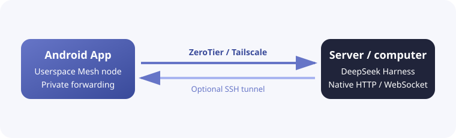

<h1 align="center">DSH Mobile Mesh</h1>

<a href="README.md">English</a> · <a href="README.zh-CN.md">中文</a> · <b>हिन्दी</b> · <a href="README.es.md">Español</a> · <a href="README.fr.md">Français</a> · <a href="README.ar.md">العربية</a> · <a href="README.bn.md">বাংলা</a> · <a href="README.pt.md">Português</a> · <a href="README.ru.md">Русский</a> · <a href="README.ur.md">اردو</a> · <a href="README.th.md">ไทย</a>

## सुविधाएँ

DSH Mobile Mesh, [DeepSeek Harness](https://github.com/deepseek-ai/deepseek-harness) के लिए एक अनौपचारिक Android रिमोट है। Agent, Shell, फ़ाइलें और workspace उसी सर्वर पर चलते हैं जहाँ DeepSeek Harness स्थापित है।

- Workspace, sessions, इतिहास और live replies देखें।
- Tool परिणाम देखें और text, images या files भेजें।
- Goals, plans, approvals, questions, jobs, workflows और subagents संभालें।
- Models, presets और skills बदलें तथा DeepSeek Harness slash commands चलाएँ।

### Mesh कनेक्शन

App Android में ZeroTier/libzt या Tailscale/tsnet userspace नेटवर्क अंतर्निर्मित रूप से चलाता है और DeepSeek Harness के native HTTP/WebSocket interface को फोन तक forward करता है। DeepSeek Harness के launch mode में बदलाव या plugin की आवश्यकता नहीं है और Android system VPN भी आवश्यक नहीं है। Direct, ZeroTier और Tailscale तीनों पर SSH forwarding जोड़ी जा सकती है, जिससे DeepSeek Harness `127.0.0.1` पर सुनता रह सकता है।

## उपयोग

1. सर्वर पर `dsh web` चलाएँ।
2. ZeroTier या Tailscale उपयोग करने से पहले DeepSeek Harness वाले सर्वर पर संबंधित node install और sign in करें: [ZeroTier](https://www.zerotier.com/download/) को install करके App वाले network से जुड़ें, या [Tailscale](https://tailscale.com/docs/install) install करके उसी Tailnet में sign in करें।
3. नवीनतम APK [GitHub Releases](https://github.com/sorsama/deepseek-harness-mobile/releases) से डाउनलोड करें।
4. Direct, ZeroTier या Tailscale चुनें; SSH इन तीनों के ऊपर वैकल्पिक layer है।
5. App के निर्देश पर DeepSeek Harness launch token भरें।

## सुरक्षा

DeepSeek Harness host पर commands चला और files पढ़/लिख सकता है। Unprotected port को public internet पर न रखें और token, SSH keys तथा Mesh identity सुरक्षित रखें।

## संगतता और प्रोटोकॉल baseline

Android ऐप का DTO baseline DeepSeek Harness `v0.2.1-rc.2` (commit `687f282e86`) पर आधारित है, जिसमें `workspace/follow` का पूर्ण `replace` snapshot, Host-निर्धारित `session/create` पहचान और 0.2.1 alpha श्रृंखला में जोड़ा गया acknowledgement-आधारित `terminal/attach` input शामिल है। Settings और connection details panel यही baseline दिखाते हैं। कनेक्शन पर ऐप मौजूदा read-only `session/list` और `session/projections` probes का उपयोग करता है और automatic reconnect के लिए पहचानी गई capabilities cache करता है; यह server version string से support का अनुमान नहीं लगाता। पुराने Host में projection route न हो तो ऐप legacy subagent API का उपयोग जारी रखता है।

`v0.2.1-rc.2` अपडेट ने ऐप के किसी endpoint को नहीं बदला: account notification फ़ील्ड परिवर्तन `account/getUnnotifiedBonuses` से संबंधित हैं, जिसे Android client उपभोग नहीं करता, और terminal client परिवर्तन अपरिवर्तित `terminal/list` response पर browser-side discovery cache है। इसलिए पुराने Host उन्हीं probes से काम करते रहते हैं, और ऐप वास्तविक उपयोग पथ के बिना किसी capability का दावा नहीं करता।

अपनाया गया 0.2.1 baseline `workspace/follow` भी शामिल करता है: पुराना `baseline` और नया `replace` दोनों workspace, archive और pin क्रम को पूरी तरह बदलते हैं। read-only `session/list` और `session/projections` probes बने रहते हैं; `session/create.sessionId` default में छोड़ा जाता है और लौटाई गई ID इस्तेमाल होती है। read-only `terminal/environment.maxBufferedBytes` फ़ील्ड नए द्विदिश `terminal/attach` stream को चुनती है; पुराने Host में इसके न होने पर `terminal/follow` और write/resize मार्ग बने रहते हैं। हर attachment में क्रमांकित command अगला भेजने से पहले Host acknowledgement की प्रतीक्षा करती है और transport window सीमा जाँचती है। `terminal/list` का परिणाम प्रति Session cache होता है और उस Session के सभी terminal views उसे साझा करते हैं; हर नई connection generation पर इसे एक बार फिर लोड किया जाता है, create और पुष्ट close cached rows को सुधारते हैं, और terminal metadata का एकमात्र स्रोत Host response ही रहता है।

ऐप बिना `kind` वाली legacy projection response और नए `session/projections` response variants दोनों स्वीकार करता है। `migration-required` को बिना sequence वाला hint माना जाता है और इसे live event watermarks के साथ merge नहीं किया जाता। `session/list.formatStatus` optional है; पुराने Host compatibility के लिए `session/fork.allowMigration` default में omit होता है। `external` mode वाले subagent records server की दी हुई metadata के साथ दिखते हैं, लेकिन Session transcript के रूप में नहीं खुलते। `terminal/environment.cwd` Host द्वारा दर्ज मौजूदा directory है।

Android की बातचीत सूची अब Host-प्रबंधित स्वचालित कार्य खोलती है। read-only `schedule/catalog` से उपलब्धता जाँची जाती है; केवल संरचित missing-route उत्तर से पुराने Host को असमर्थित माना जाता है। ऐप Host का क्रम और स्थिति दिखाता है, मूल `sessionId` के साथ `schedule/history` व `schedule/delete` बुलाता है, और टकराव पहचानने हेतु देखे गए पूरे नियम को `schedule/update.expected` में भेजता है। Web की तरह नया कार्य Session शुरू करता है जहाँ Agent reminder बनाता है। Host catalog search या status-filter API नहीं देता, इसलिए Android अलग local filter नहीं बनाता।

## संदर्भ

- [DeepSeek Harness](https://github.com/deepseek-ai/deepseek-harness)
- [OpenCode Mobile Mesh](https://github.com/chliny/opencode-mobile-mesh)
- [DeepSeek Harness Mobile](https://github.com/sorsama/deepseek-harness-mobile)

## लाइसेंस

[MIT License](LICENSE)। DeepSeek Harness और उसकी branding उनके संबंधित मालिकों की संपत्ति हैं।
