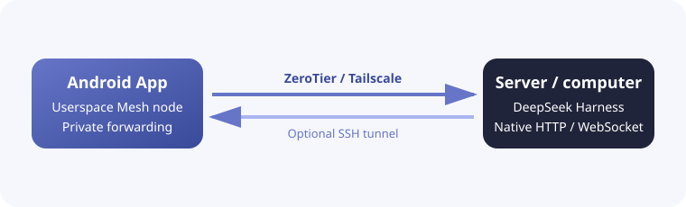

<p align="center">
  
</p>

<h1 align="center">DSH Mobile Mesh</h1>

<p align="center">
  Remote-control <b>DeepSeek Harness</b> from Android.
  <br>
  Connect through an app-private Mesh network without changing the <b>DeepSeek Harness</b> server or installing a plugin.
</p>

<p align="center">
  <b>English</b> ·
  <a href="README.zh-CN.md">中文</a> ·
  <a href="README.hi.md">हिन्दी</a> ·
  <a href="README.es.md">Español</a> ·
  <a href="README.fr.md">Français</a> ·
  <a href="README.ar.md">العربية</a> ·
  <a href="README.bn.md">বাংলা</a> ·
  <a href="README.pt.md">Português</a> ·
  <a href="README.ru.md">Русский</a> ·
  <a href="README.ur.md">اردو</a> ·
  <a href="README.th.md">ไทย</a>
</p>

<p align="center">
  
  
  <a href="LICENSE"></a>
</p>

## Features

DSH Mobile Mesh is an unofficial Android remote for [DeepSeek Harness](https://github.com/deepseek-ai/deepseek-harness). The Agent, shell, files, and workspace continue running on the computer where DeepSeek Harness is installed; the phone provides the control surface.

- Browse workspaces, sessions, and history with streaming replies.
- Inspect Markdown, reasoning, terminal, file, search, web, and diff results. Code files load in pages with viewport-lazy syntax highlighting; common configuration, markup, and stylesheet formats are also colored.
- Send text, images, and file attachments.
- Manage goals, plans, todos, approvals, user questions, jobs, workflows, and subagents.
- Select models, Agent presets, and skills, and run DeepSeek Harness slash commands.
- Search sessions, inspect trajectories and usage, export session logs, and receive completion notifications.
- Use light, dark, or system themes and the same language set as the app.

### Mesh connection

The app embeds ZeroTier/libzt or Tailscale/tsnet userspace networking on Android and forwards the native HTTP/WebSocket interface of DeepSeek Harness to the phone. DeepSeek Harness needs no launch-mode changes or plugin, and no Android system VPN is required. SSH forwarding can be layered on Direct, ZeroTier, or Tailscale, allowing DeepSeek Harness to keep listening on `127.0.0.1`.



## Usage

### 1. Start DeepSeek Harness

Start DeepSeek Harness on the server or computer using its normal command:

```bash
dsh web
```

DeepSeek Harness may keep its default `127.0.0.1:3080` listener. When using ZeroTier or Tailscale, first install and sign in to the corresponding network client on the server or computer where DeepSeek Harness runs, then make sure that node can reach DeepSeek Harness:

- [Install ZeroTier](https://www.zerotier.com/download/) and join the same ZeroTier network as the app.
- [Install Tailscale](https://tailscale.com/docs/install) and sign in to the same Tailnet as the app.

For direct Mesh access, make sure the server is reachable through the selected ZeroTier network or Tailnet.

### 2. Install the app

Download the latest APK from [GitHub Releases](https://github.com/sorsama/deepseek-harness-mobile/releases) and install it on Android. Use only the official project Release page.

### 3. Add a connection

Choose one base connection method in the app:

- **Direct**: enter an address that Android can route to the DeepSeek Harness endpoint.
- **ZeroTier**: enter the server's ZeroTier address and network ID, then authorize the network if requested.
- **Tailscale**: enter the server's Tailscale address and complete sign-in if requested.

SSH is an optional transport layer for all three methods, not a fourth method. Enter the SSH host, port, username, and password or private key. Set the remote DeepSeek Harness host to `127.0.0.1` and its port to `3080` when DeepSeek Harness is loopback-only. The app reaches SSH through Direct, ZeroTier, or Tailscale, then forwards the DeepSeek Harness connection through SSH.

Enter the DeepSeek Harness launch token when the app requests it. Saved connection settings remain in app-private storage.

## Security

DeepSeek Harness can execute commands and read or write files on its host. Any client that can access the DeepSeek Harness API has near-shell-level authority on that host.

- Prefer ZeroTier, Tailscale, or SSH instead of exposing an unprotected DeepSeek Harness port to the public internet.
- Use unencrypted LAN connections only on networks you trust.
- Protect launch tokens, SSH keys, ZeroTier Planet files, and Tailscale identity data.
- Remember that attachments are copied to the DeepSeek Harness host and can be read by the Agent.

## Compatibility and protocol baseline

The Android app protocol DTO baseline tracks DeepSeek Harness `v0.2.2-rc.1` (commit `66491b05e3`). The wire types were also checked against upstream `master` at `fcc0ad4621`, which is 811 commits past that release and is not itself a release; where that branch already changed a shape the app calls, the app keeps both forms. The displayed protocol baseline in Settings and the connection details panel reports the `v0.2.2-rc.1` release. On connection the app uses the existing read-only `session/list` and `session/projections` probes and caches observed capabilities for automatic reconnects; it does not infer capabilities from a server version string. Hosts without the projection route continue through the legacy subagent API.

`v0.2.2-rc.1` keeps every route this app already called but changes three request shapes. `session/attachment` now takes the complete `ImageAttachmentRef` instead of a bare `attachmentId`; Android sends both members, and Hosts at both generations discard the request member they do not declare, so image reads need no capability probe. `session/follow` only resumes a prepared ordinary Session when the request sets `activate`; Android always asks for activation, which restores the pre-0.2.2 background-promotion behavior on new Hosts and is discarded by older ones, while subagent transcripts stay passive. `session/control` projection frames may carry several key changes for one committed event; the app normalizes the legacy single-key frame and accepts both. The narrowed `session/list` projection summary no longer repeats host-wide values such as `imageLimits`; the app reads those from `session/projections` and the control baseline and never treats a missing summary key as a missing capability. A subagent catalog `name` provided by the Host is displayed alongside the existing `label`; when an older Host does not provide it, the existing display remains unchanged. Model badges from the catalog are shown beside the model name, using the Host's English text when the reader's language is absent, and a failed plugin entry shows the Host-reported startup diagnostic. The Agent Team task board published in the current Session's `agentTeam` projection is rendered in the details panel in Host order, including the Host's readiness, write-scope warnings, and a prominent notice when the board is only the last valid state after a rejected update; an older Host without the projection shows no board.

The details panel also surfaces the Host's passive Session state through read-only `session/state` and the `session/observeState` stream: active/running flags, whether the pending queue is readable and how many items it holds, and the pending-input categories sampled at the last state read. A user-initiated `Wait up to 20 seconds` calls `session/wait` once, reports the Host's `idle`, `input-required`, or `timeout` reason, notes truncated assistant output, and never stops the Session; a wait that fails at the transport level is reported as a failure, never as a Host timeout. The affected surface is hidden only when the Host answers with a structured missing route for its own endpoint, and permission or unrelated errors are shown as errors rather than treated as an older Host.

For history pagination and subagent previews, the app prefers read-only `session/events`. Only evidence that this route itself is absent triggers fallback — the gateway's missing-endpoint error on a stream, or the shared handler's HTTP 404 on a unary call: pagination uses `session/page`, and subagent previews use the first frame of `session/follow`. Timeouts and permission errors do not trigger fallback. Because their semantics differ, `session/follow` and `session/control` remain in use for main-session snapshots and live state.

A completed `apply_patch` result renders only the hunks the Host reports it applied; when the patch stopped early the card says so and keeps the Host's own stopped-operation detail, while a running call, an error, or missing metadata keeps the generic result text.

Two further wire changes are handled defensively. Upstream `master` renamed `subagents/interruptByParent` to `subagents/interruptByUser` with one argument before any release carried it; the app uses the user form when a Host answers it and falls back to the parent form only when the Host reports that route itself missing, so stopping a subagent works on released Hosts and on current `master` builds alike. A `userQuestions` request may carry a new `approval` presentation intent; the app decodes that variant as a generic question card, and an unknown future intent degrades to the same generic flow instead of dropping the request.

The adopted baseline also covers `workspace/follow`: both the old opening `baseline` frame and the complete `replace` increment are accepted, and either snapshot replaces workspace rows, archive state, and pin order. The existing read-only capability probes still select legacy session routes, while missing-route evidence alone marks them unsupported. `session/create` omits optional `sessionId` and uses the returned ID. The read-only `terminal/environment.maxBufferedBytes` field selects the new `terminal/attach` bidirectional stream; on older Hosts where it is absent, the app retains `terminal/follow` and the existing write/resize routes. Modern commands are numbered per attachment and await Host acknowledgements before sending the next command; carrier input-window limits are enforced before sending. `terminal/list` discovery is cached per Session and shared by every terminal view of that Session, reloaded once for each new connection generation; creation and confirmed closure amend the cached rows, and the Host response remains the only source of terminal metadata.

Remote results that carry native bytes arrive as `multipart/form-data`: a `metadata` part holds the ordinary server-response envelope with each byte field left `null`, and the binary parts are spliced back into those fields before decoding. Workspace byte reads — and therefore the workspace images the app renders inside Markdown messages — use that path, so they keep working against Hosts from Harness 0.2.0 on; a Host that still answers with a JSON byte array or base64 string decodes as before.

The app accepts both legacy projection responses (`asOfSeq` and `values`, with no `kind`) and the current `session/projections` response variants. A `migration-required` response is treated as a non-sequenced hint and is never merged with live event watermarks. New `session/list.formatStatus` is optional, and `session/fork.allowMigration` remains omitted unless explicitly requested, preserving legacy host behavior. The catalog's new `external` subagent mode is displayed as server-provided work metadata, but is not navigated as a session transcript. The `terminal/environment.cwd` value is the host's logged current directory; existing terminal metadata remains host-authoritative.

The Android conversation list now opens Host-owned automation tasks. A read-only `schedule/catalog` request checks availability; only a missing-route answer marks a Host without Schedule support. `v0.2.2-rc.1` moved task mutation to `schedule/edit` and made catalog rows carry a delivery `target`, an `active`/`paused`/`ended` status, and an `updatedAt` revision. The app attempts the modern edit route and falls back to `schedule/update` and `schedule/delete` only when the Host reports that route itself missing, remembering the result for the connection generation: the modern path sends the observed `updatedAt` as `expectedUpdatedAt`, opens the target Session from the row, and renders the newer statuses, while the legacy path keeps the complete observed rule as `expected`. Both catalog row shapes decode, so old and new Hosts render the same list. When the Host exposes the newer management routes, the app creates a task directly with `schedule/create` — delivering to an existing Session, one Session created at first delivery, or a new Session per delivery — pauses and resumes it through `schedule/edit`, runs one occurrence with `schedule/run` without moving the schedule, and removes ended tasks in one confirmed `schedule/deleteInactive` call; `schedule/deliveryLimits` supplies the minimum new-Session interval the Host enforces. Each failure is classified from evidence: a missing route affects only that action and is reported as unsupported, a Host business rejection is shown with the Host's own message, and only transport-level failures are reported as an unknown outcome that the reader must refresh before retrying. When those routes are absent, creation still starts a Session as on the Web and reminders are created by asking its Agent. Host catalog search/filter APIs are not available, so Android does not invent a separate client-side search or status filter.


## Project structure

| Path | Purpose |
|---|---|
| `androidApp/` | Android UI, connections, notifications, Mesh, and SSH forwarding |
| `core/` | DeepSeek Harness RPC, HTTP/WebSocket, streaming events, and session models |
| `shared/` | Kotlin Multiplatform shared code |
| `mock-harness/` | Test DeepSeek Harness API service |
| `tailscale/` | Tailscale tsnet userspace component |
| `third_party/libzt/` | ZeroTier libzt component |
| `scripts/` | Native and Mesh build scripts |

## References

- [DeepSeek Harness](https://github.com/deepseek-ai/deepseek-harness)
- [OpenCode Mobile Mesh](https://github.com/chliny/opencode-mobile-mesh)
- [DeepSeek Harness Mobile](https://github.com/sorsama/deepseek-harness-mobile)

## License

[MIT License](LICENSE). DeepSeek Harness and its branding belong to their respective owners; this is an independent community project.
