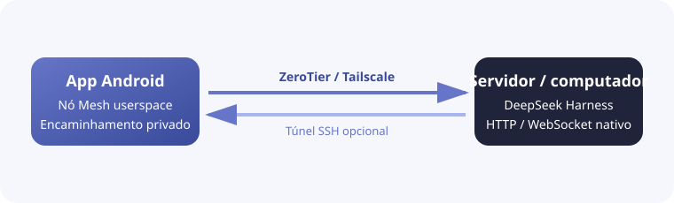

<h1 align="center">DSH Mobile Mesh</h1>

<a href="README.md">English</a> · <a href="README.zh-CN.md">中文</a> · <a href="README.hi.md">हिन्दी</a> · <a href="README.es.md">Español</a> · <a href="README.fr.md">Français</a> · <a href="README.ar.md">العربية</a> · <a href="README.bn.md">বাংলা</a> · <b>Português</b> · <a href="README.ru.md">Русский</a> · <a href="README.ur.md">اردو</a> · <a href="README.th.md">ไทย</a>

## Funcionalidades

DSH Mobile Mesh é um controle remoto Android não oficial para o [DeepSeek Harness](https://github.com/deepseek-ai/deepseek-harness). O Agent, Shell, os arquivos e o workspace continuam no servidor onde o DeepSeek Harness está instalado.

- Navegar por workspaces, sessões, histórico e respostas em tempo real.
- Ver resultados de ferramentas e enviar texto, imagens e arquivos.
- Gerenciar objetivos, planos, aprovações, perguntas, tarefas, workflows e subagentes.
- Trocar modelos, presets e skills e executar comandos slash do DeepSeek Harness.

### Conexão Mesh

O app integra no Android uma rede userspace ZeroTier/libzt ou Tailscale/tsnet e encaminha para o telefone a interface HTTP/WebSocket nativa do DeepSeek Harness. O DeepSeek Harness não precisa de alterações no modo de inicialização nem de plugins, e não é necessária uma VPN do sistema Android. SSH pode ser combinado com Direct, ZeroTier ou Tailscale, permitindo que o DeepSeek Harness continue ouvindo em `127.0.0.1`.

## Uso

1. Execute `dsh web` no servidor.
2. Antes de usar ZeroTier ou Tailscale, instale e faça login no nó correspondente do servidor onde o DeepSeek Harness está em execução: instale o [ZeroTier](https://www.zerotier.com/download/) e entre na mesma rede do app, ou instale o [Tailscale](https://tailscale.com/docs/install) e faça login no mesmo Tailnet.
3. Baixe o APK em [GitHub Releases](https://github.com/sorsama/deepseek-harness-mobile/releases).
4. Escolha Direct, ZeroTier ou Tailscale; SSH é uma camada opcional para os três.
5. Informe o launch token do DeepSeek Harness quando solicitado.

## Segurança

O DeepSeek Harness pode executar comandos e ler ou escrever arquivos no host. Não exponha uma porta sem proteção à Internet e proteja tokens, chaves SSH e dados de identidade Mesh.

## Compatibilidade e referência do protocolo

A referência de DTO do protocolo do app Android acompanha o DeepSeek Harness `v0.2.2-rc.1` (commit `66491b05e3`). Os tipos de dados do protocolo também foram verificados contra o `master` upstream em `fcc0ad4621`, que está 811 commits à frente dessa versão e não é ele próprio uma versão; onde esse ramo já alterou uma forma que o app chama, o app mantém as duas formas. A referência de protocolo exibida nas configurações e no painel de detalhes da conexão informa a versão `v0.2.2-rc.1`. Ao conectar, o app usa as sondagens existentes somente de leitura `session/list` e `session/projections` e armazena as capacidades observadas para reconexões automáticas; não deduz capacidades a partir de uma string de versão do servidor. Hosts sem a rota de projection continuam pela API legada de subagent.

`v0.2.2-rc.1` mantém todas as rotas que este app já chamava, mas altera três formas de requisição. `session/attachment` agora recebe o `ImageAttachmentRef` completo em vez de um `attachmentId` isolado; o Android envia os dois membros, e Hosts de ambas as gerações descartam o membro da requisição que não declaram, então a leitura de imagens não precisa de sondagem de capacidade. `session/follow` só retoma uma Session normal preparada quando a requisição define `activate`; o Android sempre solicita a ativação, o que restaura nos Hosts novos o comportamento de promoção em segundo plano anterior a 0.2.2 e é descartado pelos antigos, enquanto os transcripts de subagent permanecem passivos. Os frames de projection de `session/control` podem carregar várias mudanças de chave para um único evento confirmado; o app normaliza o frame legado de chave única e aceita os dois. O resumo de projection reduzido de `session/list` não repete mais valores de todo o Host, como `imageLimits`; o app lê esses valores de `session/projections` e da referência de controle e nunca trata uma chave ausente do resumo como capacidade ausente. O `name` do catálogo de subagent fornecido pelo Host é exibido junto ao `label` existente; quando um Host antigo não o fornece, a exibição anterior permanece inalterada. Os badges de modelo do catálogo são exibidos ao lado do nome do modelo, usando o texto em inglês do Host quando falta o idioma do leitor, e uma entrada de plugin com falha mostra o diagnóstico de inicialização informado pelo Host. O quadro de tarefas do Agent Team publicado na projeção `agentTeam` da Session atual é renderizado no painel de detalhes na ordem do Host, incluindo a prontidão do Host, os avisos de escopo de escrita e um aviso destacado quando o quadro é apenas o último estado válido após uma atualização rejeitada; um Host antigo sem a projeção não mostra quadro algum.

O painel de detalhes também expõe o estado passivo da Session do Host por meio de `session/state` e do fluxo `session/observeState`, ambos somente de leitura: indicadores de active/running, se a fila pendente pode ser lida e quantos itens ela contém, e as categorias de entrada pendente amostradas na última leitura de estado. A ação iniciada pelo usuário “Aguardar até 20 segundos” chama `session/wait` uma vez, informa o motivo `idle`, `input-required` ou `timeout` do Host, avisa que a saída do assistente foi truncada e nunca interrompe a Session; uma espera que falha no nível de transporte é informada como falha, nunca como um timeout do Host. A superfície afetada só é ocultada quando o Host responde com uma rota ausente estruturada para o próprio endpoint, e erros de permissão ou não relacionados são exibidos como erros em vez de tratados como um Host antigo.

Para paginação do histórico e prévias de subagentes, o app prefere `session/events` somente de leitura. Só a evidência de que essa rota em si está ausente aciona a alternativa — o erro de endpoint ausente do gateway em um stream, ou o HTTP 404 do handler compartilhado em uma chamada unária: usa `session/page` para paginação e o primeiro frame de `session/follow` para prévias. Tempo esgotado e erros de permissão não provocam essa alternativa. Por terem semânticas diferentes, `session/follow` e `session/control` continuam sendo usados para o snapshot e o estado em tempo real da sessão principal.

Um resultado `apply_patch` concluído renderiza apenas os hunks que o Host informa ter aplicado; quando o patch parou antes do fim, o cartão indica isso e mantém o detalhe do próprio Host sobre a operação interrompida, enquanto uma chamada em execução, um erro ou metadados ausentes mantêm o texto de resultado genérico.

Dois outros cambios de transmissão são tratados de forma defensiva. O `master` upstream renomeou `subagents/interruptByParent` para `subagents/interruptByUser` com um argumento antes de qualquer versão carregá-lo; o app usa a forma de usuário quando um Host responde a ela e só volta à forma parent quando o Host informa que essa rota em si está ausente, então parar um subagent funciona tanto em Hosts publicados quanto em builds atuais do `master`. Uma requisição `userQuestions` pode carregar um novo intent de apresentação `approval`; o app decodifica essa variante como um cartão de pergunta genérico, e um intent futuro desconhecido degrada para o mesmo fluxo genérico em vez de descartar a requisição.

A referência 0.2.1 adotada também cobre `workspace/follow`: tanto o antigo `baseline` quanto o novo `replace` substituem por completo workspaces, arquivos e ordem dos fixados. As sondagens de leitura `session/list` e `session/projections` permanecem; `session/create.sessionId` é omitido por padrão e o ID retornado é usado. O campo somente de leitura `terminal/environment.maxBufferedBytes` seleciona o fluxo bidirecional `terminal/attach`; em Hosts antigos sem ele, permanecem `terminal/follow` e as rotas write/resize. Comandos numerados por conexão aguardam o reconhecimento do Host antes do próximo envio e respeitam os limites da janela de transporte. O resultado de `terminal/list` é armazenado por Session e compartilhado por todas as views de terminal dessa Session; ele é recarregado uma vez a cada nova geração de conexão, e criação e fechamento confirmado ajustam as linhas armazenadas, enquanto a resposta do Host continua sendo a única fonte de metadados do terminal.

Resultados Remote que carregam bytes nativos chegam como `multipart/form-data`: uma parte `metadata` contém o envelope server-response comum com cada campo de bytes deixado como `null`, e as partes binárias são reinseridas nesses campos antes da decodificação. As leituras de bytes do workspace — e, portanto, as imagens do workspace que o app exibe dentro das mensagens Markdown — usam esse caminho, então continuam funcionando em Hosts a partir do Harness 0.2.0; um Host que ainda responde com um array de bytes JSON ou uma string base64 é decodificado como antes.

O app aceita tanto respostas antigas de projection sem `kind` quanto as variantes atuais de `session/projections`. `migration-required` é tratado como uma indicação sem sequência e não é mesclado com marcas de eventos ao vivo. `session/list.formatStatus` é opcional e `session/fork.allowMigration` é omitido por padrão para manter a compatibilidade com Hosts antigos. Registros de subagent no modo `external` são exibidos com os metadados do servidor, mas não são abertos como transcript de Session. `terminal/environment.cwd` representa o diretório atual registrado pelo Host.

A lista de conversas do Android agora abre tarefas automáticas pertencentes ao Host. Uma requisição somente de leitura `schedule/catalog` verifica a disponibilidade; apenas uma resposta de rota ausente marca um Host sem suporte a Schedule. `v0.2.2-rc.1` moveu a mutação de tarefas para `schedule/edit` e fez as linhas do catálogo carregarem um `target` de entrega, um status `active`/`paused`/`ended` e uma revisão `updatedAt`. O app tenta a rota de edição moderna e só recorre a `schedule/update` e `schedule/delete` quando o Host informa que essa rota em si está ausente, lembrando o resultado para a geração de conexão: o caminho moderno envia o `updatedAt` observado como `expectedUpdatedAt`, abre a Session de destino a partir da linha e exibe os novos status, enquanto o caminho legado mantém a regra completa observada como `expected`. As duas formas de linha do catálogo são decodificadas, então Hosts antigos e novos renderizam a mesma lista. Quando o Host expõe as novas rotas de gestão, o app cria uma tarefa diretamente com `schedule/create` — entregando a uma Session existente, a uma Session criada na primeira entrega ou a uma nova Session por entrega —, pausa e retoma por meio de `schedule/edit`, executa uma ocorrência com `schedule/run` sem mover o agendamento e remove as tarefas encerradas em uma única chamada confirmada a `schedule/deleteInactive`; `schedule/deliveryLimits` fornece o intervalo mínimo para novas Sessions que o Host aplica. Cada falha é classificada a partir da evidência: uma rota ausente afeta apenas essa ação e é informada como não suportada, uma rejeição de negócio do Host é exibida com a mensagem do próprio Host, e apenas falhas no nível de transporte são informadas como resultado desconhecido que o leitor deve atualizar antes de tentar novamente. Quando essas rotas não existem, a criação ainda inicia uma Session como na Web e os lembretes são criados pedindo ao Agent dela. As APIs de busca/filtro do catálogo do Host não estão disponíveis, então o Android não inventa uma busca nem um filtro de status locais separados.

## Referências

- [DeepSeek Harness](https://github.com/deepseek-ai/deepseek-harness)
- [OpenCode Mobile Mesh](https://github.com/chliny/opencode-mobile-mesh)
- [DeepSeek Harness Mobile](https://github.com/sorsama/deepseek-harness-mobile)

## Licença

[MIT License](LICENSE). DeepSeek Harness e sua marca pertencem aos respectivos proprietários.
