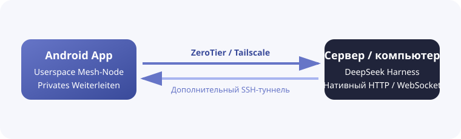

<h1 align="center">DSH Mobile Mesh</h1>

<a href="README.md">English</a> · <a href="README.zh-CN.md">中文</a> · <a href="README.hi.md">हिन्दी</a> · <a href="README.es.md">Español</a> · <a href="README.fr.md">Français</a> · <a href="README.ar.md">العربية</a> · <a href="README.bn.md">বাংলা</a> · <a href="README.pt.md">Português</a> · <b>Русский</b> · <a href="README.ur.md">اردو</a> · <a href="README.th.md">ไทย</a>

## Возможности

DSH Mobile Mesh — неофициальный Android-клиент для удалённого управления [DeepSeek Harness](https://github.com/deepseek-ai/deepseek-harness). Agent, Shell, файлы и workspace продолжают работать на сервере с установленным DeepSeek Harness.

- Просмотр workspaces, сессий, истории и потоковых ответов.
- Просмотр результатов инструментов и отправка текста, изображений и файлов.
- Управление целями, планами, подтверждениями, вопросами, задачами, workflow и субагентами.
- Выбор моделей, presets и skills, запуск slash-команд DeepSeek Harness.

### Mesh-подключение

Приложение встроенно запускает на Android userspace-сеть ZeroTier/libzt или Tailscale/tsnet и передаёт на телефон нативный HTTP/WebSocket-интерфейс DeepSeek Harness. DeepSeek Harness не требует изменения способа запуска или установки плагинов, а системный VPN Android не нужен. SSH можно добавить к Direct, ZeroTier или Tailscale, чтобы DeepSeek Harness продолжал слушать `127.0.0.1`.

## Использование

1. Запустите на сервере `dsh web`.
2. Перед использованием ZeroTier или Tailscale установите и авторизуйте соответствующий узел на сервере, где работает DeepSeek Harness: установите [ZeroTier](https://www.zerotier.com/download/) и подключитесь к той же сети, что и приложение, либо установите [Tailscale](https://tailscale.com/docs/install) и войдите в тот же Tailnet.
3. Скачайте APK из [GitHub Releases](https://github.com/sorsama/deepseek-harness-mobile/releases).
4. Выберите Direct, ZeroTier или Tailscale; SSH — дополнительный слой для всех трёх вариантов.
5. Введите launch token DeepSeek Harness по запросу.

## Безопасность

DeepSeek Harness может выполнять команды и читать или изменять файлы на хосте. Не открывайте незащищённый порт в Интернет и защищайте токены, SSH-ключи и данные Mesh.

## Совместимость и базовая версия протокола

Базой DTO протокола приложения Android служит DeepSeek Harness `v0.2.2-rc.1` (commit `66491b05e3`). Типы передачи также сверены с upstream `master` на `fcc0ad4621`, который опережает этот выпуск на 811 commits и сам не является выпуском; там, где эта ветка уже изменила вызываемую приложением форму, приложение сохраняет обе формы. Отображаемая в настройках и на панели сведений о подключении базовая версия протокола соответствует выпуску `v0.2.2-rc.1`. При подключении приложение использует существующие read-only проверки `session/list` и `session/projections` и кэширует обнаруженные возможности для автоматических переподключений; оно не выводит возможности из строки версии сервера. Host без маршрута projection продолжают работу через прежний subagent API.

`v0.2.2-rc.1` сохраняет все маршруты, которые приложение уже вызывало, но меняет три формы запросов. `session/attachment` теперь принимает полный `ImageAttachmentRef` вместо одного `attachmentId`; Android отправляет оба члена, а Host обоих поколений отбрасывают тот член запроса, который не объявляют, поэтому чтению изображений не нужна проверка возможностей. `session/follow` возобновляет подготовленную обычную Session, только если запрос задаёт `activate`; Android всегда запрашивает активацию, что восстанавливает на новых Host поведение фонового продвижения до 0.2.2 и игнорируется старыми, тогда как transcripts subagent остаются пассивными. Кадры projection в `session/control` могут нести несколько изменений ключей для одного подтверждённого события; приложение нормализует старый кадр с одним ключом и принимает обе формы. Суженная сводка projection в `session/list` больше не повторяет общие для всего Host значения, такие как `imageLimits`; приложение читает их из `session/projections` и контрольной базы и никогда не считает отсутствующий ключ сводки отсутствующей возможностью. Предоставленный Host параметр `name` каталога subagent отображается вместе с существующим `label`; если старый Host его не предоставляет, прежнее отображение сохраняется. Значки моделей из каталога показываются рядом с названием модели, при отсутствии языка читателя используется английский текст от Host, а запись плагина с ошибкой показывает диагностику запуска, сообщённую Host. Доска задач Agent Team, опубликованная в projection `agentTeam` текущего сеанса, отображается на панели сведений в порядке Host, включая готовность Host, предупреждения об области записи и заметное уведомление, когда доска является лишь последним корректным состоянием после отклонённого обновления; старый Host без этого projection не показывает доску.

Панель сведений также показывает пассивное состояние сеанса Host через `session/state` и поток `session/observeState` (только чтение): флаги active/running, доступна ли очередь ожидания для чтения и сколько в ней элементов, а также категории ожидающего ввода, зафиксированные при последнем чтении состояния. Инициированное пользователем действие «Ждать до 20 секунд» один раз вызывает `session/wait`, сообщает причину `idle`, `input-required` или `timeout` от Host, отмечает усечённый вывод ассистента и никогда не останавливает сеанс; ожидание, завершившееся сбоем на транспортном уровне, показывается как ошибка, а не как тайм-аут Host. Затронутая поверхность скрывается только тогда, когда Host отвечает структурированным отсутствием маршрута для собственного endpoint, а ошибки доступа или посторонние ошибки показываются как ошибки, а не трактуются как старый Host.

Для постраничной загрузки истории и предпросмотра подагентов приложение предпочитает `session/events` только для чтения. Переход на альтернативу происходит лишь при свидетельстве того, что этого маршрута действительно нет — ошибка отсутствующего endpoint от шлюза в потоке или HTTP 404 от общего обработчика при унарном вызове: для страниц используется `session/page`, для предпросмотра — первый кадр `session/follow`. Тайм-ауты и ошибки доступа такой переход не вызывают. Из-за различий в семантике `session/follow` и `session/control` по-прежнему используются для снимка и текущего состояния основной сессии.

Завершённый результат `apply_patch` показывает только те hunks, которые Host сообщает как применённые; если патч остановился раньше времени, карточка сообщает об этом и сохраняет собственное описание Host об остановленной операции, а выполняющийся вызов, ошибка или отсутствующие метаданные сохраняют общий текст результата.

Ещё два изменения передачи обрабатываются защитно. Upstream `master` переименовал `subagents/interruptByParent` в `subagents/interruptByUser` с одним аргументом до того, как это вошло в какой-либо выпуск; приложение использует пользовательскую форму, когда Host отвечает на неё, и возвращается к форме parent только когда Host сообщает, что этого маршрута действительно нет, поэтому остановка subagent работает и на выпущенных Host, и на текущих сборках `master`. Запрос `userQuestions` может нести новое намерение представления `approval`; приложение декодирует этот вариант как обычную карточку вопроса, а неизвестное будущее намерение сводится к тому же общему потоку вместо отбрасывания запроса.

Принятая базовая версия 0.2.1 также охватывает `workspace/follow`: старый `baseline` и новый `replace` полностью заменяют рабочие области, архив и порядок закрепления. Проверки чтения `session/list` и `session/projections` сохранены; `session/create.sessionId` по умолчанию пропускается, используется возвращённый ID. Поле чтения `terminal/environment.maxBufferedBytes` выбирает двусторонний поток `terminal/attach`; на старых Host без него остаются `terminal/follow` и вызовы write/resize. Команды нумеруются на каждое подключение, ждут подтверждения Host до следующей отправки и учитывают предел транспортного окна. Результат `terminal/list` кэшируется для каждой Session и используется всеми представлениями терминала этой Session; он перезагружается один раз для каждого нового поколения соединения, создание и подтверждённое закрытие правят кэшированные строки, а единственным источником метаданных терминала остаётся ответ Host.

Результаты Remote, несущие собственные байты, приходят как `multipart/form-data`: часть `metadata` содержит обычный конверт server-response, в котором каждое поле с байтами оставлено `null`, а двоичные части вставляются обратно в эти поля перед декодированием. Чтение байтов рабочей области — а значит, и изображения рабочей области, которые приложение показывает в сообщениях Markdown, — использует этот путь, поэтому продолжает работать с Host от Harness 0.2.0 и новее; Host, который по-прежнему отвечает массивом байтов JSON или строкой base64, декодируется как раньше.

Приложение принимает как старые ответы projection без `kind`, так и новые варианты `session/projections`. Ответ `migration-required` считается подсказкой без последовательности и не объединяется с водяными знаками событий реального времени. `session/list.formatStatus` — необязательное поле, а `session/fork.allowMigration` по умолчанию не отправляется для совместимости со старыми Host. Записи subagent с режимом `external` отображаются с метаданными сервера, но не открываются как transcript Session. `terminal/environment.cwd` — текущий каталог, записанный Host.

Список бесед Android теперь открывает автоматические задачи, принадлежащие Host. Запрос чтения `schedule/catalog` проверяет доступность; только ответ об отсутствии маршрута помечает Host как не поддерживающий Schedule. `v0.2.2-rc.1` перенёс изменение задач на `schedule/edit` и добавил в строки каталога `target` доставки, статус `active`/`paused`/`ended` и ревизию `updatedAt`. Приложение пытается использовать современный маршрут редактирования и возвращается к `schedule/update` и `schedule/delete` только когда Host сообщает, что этого маршрута действительно нет, запоминая результат для поколения соединения: современный путь отправляет наблюдаемый `updatedAt` как `expectedUpdatedAt`, открывает целевую Session из строки и отображает новые статусы, а прежний путь сохраняет полное наблюдаемое правило как `expected`. Обе формы строк каталога декодируются, поэтому старые и новые Host показывают один и тот же список. Когда Host предоставляет новые маршруты управления, приложение создаёт задачу напрямую через `schedule/create` — с доставкой в существующий сеанс, в один сеанс, созданный при первой доставке, или в новый сеанс на каждую доставку —, приостанавливает и возобновляет её через `schedule/edit`, запускает одно выполнение через `schedule/run`, не сдвигая расписание, и удаляет завершённые задачи одним подтверждённым вызовом `schedule/deleteInactive`; `schedule/deliveryLimits` задаёт минимальный интервал для новых сеансов, который применяет Host. Каждый сбой классифицируется по свидетельствам: отсутствующий маршрут затрагивает только это действие и сообщается как неподдерживаемое, бизнес-отказ Host показывается с его собственным сообщением, и только сбои на транспортном уровне сообщаются как неизвестный результат, который читателю нужно обновить перед повтором. Когда этих маршрутов нет, создание по-прежнему запускает сеанс, как в Web, а напоминания создаются по запросу к его Agent. API поиска и фильтрации каталога Host недоступны, поэтому Android не создаёт отдельный локальный поиск или фильтр статуса.

## Ссылки

- [DeepSeek Harness](https://github.com/deepseek-ai/deepseek-harness)
- [OpenCode Mobile Mesh](https://github.com/chliny/opencode-mobile-mesh)
- [DeepSeek Harness Mobile](https://github.com/sorsama/deepseek-harness-mobile)

## Лицензия

[MIT License](LICENSE). DeepSeek Harness и его брендинг принадлежат соответствующим владельцам.
