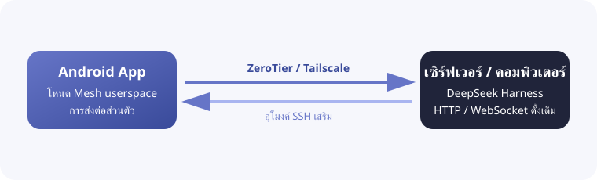

<h1 align="center">DSH Mobile Mesh</h1>

<a href="README.md">English</a> · <a href="README.zh-CN.md">中文</a> · <a href="README.hi.md">हिन्दी</a> · <a href="README.es.md">Español</a> · <a href="README.fr.md">Français</a> · <a href="README.ar.md">العربية</a> · <a href="README.bn.md">বাংলা</a> · <a href="README.pt.md">Português</a> · <a href="README.ru.md">Русский</a> · <a href="README.ur.md">اردو</a> · <b>ไทย</b>

## คุณสมบัติ

DSH Mobile Mesh คือรีโมต Android แบบไม่เป็นทางการสำหรับ [DeepSeek Harness](https://github.com/deepseek-ai/deepseek-harness) โดย Agent, Shell, ไฟล์ และ workspace ยังคงทำงานบนเซิร์ฟเวอร์ที่ติดตั้ง DeepSeek Harness

- ดู workspace, session, ประวัติ และคำตอบแบบสตรีม
- ดูผลลัพธ์ของเครื่องมือ และส่งข้อความ รูปภาพ หรือไฟล์
- จัดการ goals, plans, approvals, questions, jobs, workflows และ subagents
- เปลี่ยนโมเดล presets และ skills รวมถึงเรียกใช้ slash commands ของ DeepSeek Harness

### การเชื่อมต่อ Mesh

แอปมีเครือข่าย ZeroTier/libzt หรือ Tailscale/tsnet แบบ userspace ใน Android และส่งต่อ native HTTP/WebSocket interface ของ DeepSeek Harness ไปยังโทรศัพท์ ไม่ต้องเปลี่ยนวิธีเริ่มทำงานของ DeepSeek Harness หรือติดตั้ง plugin และไม่ต้องใช้ VPN ระดับระบบของ Android สามารถเพิ่ม SSH บน Direct, ZeroTier หรือ Tailscale ได้ ทำให้ DeepSeek Harness ยังคงรับฟังที่ `127.0.0.1`

## วิธีใช้

1. เรียกใช้ `dsh web` บนเซิร์ฟเวอร์
2. ก่อนใช้ ZeroTier หรือ Tailscale ให้ติดตั้งและลงชื่อเข้าใช้ node ที่เกี่ยวข้องบนเซิร์ฟเวอร์ซึ่งรัน DeepSeek Harness: ติดตั้ง [ZeroTier](https://www.zerotier.com/download/) และเข้าร่วม network เดียวกับแอป หรือ ติดตั้ง [Tailscale](https://tailscale.com/docs/install) และลงชื่อเข้าใช้ Tailnet เดียวกัน
3. ดาวน์โหลด APK จาก [GitHub Releases](https://github.com/sorsama/deepseek-harness-mobile/releases)
4. เลือก Direct, ZeroTier หรือ Tailscale โดย SSH เป็นชั้นเสริมสำหรับทั้งสามแบบ
5. ป้อน launch token ของ DeepSeek Harness เมื่อแอปแจ้ง

## ความปลอดภัย

DeepSeek Harness สามารถรันคำสั่งและอ่านเขียนไฟล์บนเครื่องโฮสต์ได้ อย่าเปิดพอร์ตที่ไม่มีการป้องกันสู่สาธารณะ และรักษา token, SSH key และข้อมูล Mesh ให้ปลอดภัย

## ความเข้ากันได้และฐานโปรโตคอล

ฐาน DTO ของโปรโตคอลในแอป Android อ้างอิง DeepSeek Harness `v0.2.2-rc.1` (commit `66491b05e3`) ชนิดข้อมูลบนสายยังถูกตรวจเทียบกับ `master` ต้นทางที่ `fcc0ad4621` ซึ่งนำหน้ารุ่นนั้นอยู่ 811 commits และไม่ใช่รุ่นที่เผยแพร่เอง เมื่อสาขานั้นเปลี่ยนรูปร่างที่แอปเรียกอยู่แล้ว แอปจะเก็บทั้งสองรูปแบบไว้ ฐานโปรโตคอลที่แสดงในหน้าตั้งค่าและแผงรายละเอียดการเชื่อมต่อระบุรุ่น `v0.2.2-rc.1` เมื่อเชื่อมต่อ แอปใช้ probe แบบอ่านอย่างเดียวที่มีอยู่แล้วสำหรับ `session/list` และ `session/projections` และบันทึก capability ที่ตรวจพบไว้ใช้เมื่อเชื่อมต่ออัตโนมัติใหม่ โดยไม่อนุมาน capability จากสตริงเวอร์ชันของเซิร์ฟเวอร์ Host ที่ไม่มี route projection ยังทำงานผ่าน subagent API แบบเดิม

`v0.2.2-rc.1` เก็บทุก route ที่แอปนี้เรียกอยู่แล้ว แต่เปลี่ยนรูปร่างคำขอสามจุด `session/attachment` รับ `ImageAttachmentRef` แบบเต็มแทน `attachmentId` เดี่ยว ๆ โดย Android ส่งทั้งสองสมาชิก และ Host ทั้งสองรุ่นจะทิ้งสมาชิกของคำขอที่ตนไม่ได้ประกาศไว้ การอ่านรูปภาพจึงไม่ต้อง probe capability `session/follow` จะกลับมาทำงานต่อกับ Session ปกติที่เตรียมไว้เฉพาะเมื่อคำขอกำหนด `activate` โดย Android ขอ activate เสมอ ซึ่งคืนพฤติกรรมการเลื่อนขึ้นเบื้องหลังก่อน 0.2.2 บน Host รุ่นใหม่ และจะถูกทิ้งโดยรุ่นเก่า ส่วน transcript ของ subagent ยังคงไม่ทำงานเอง projection frame ของ `session/control` อาจมีการเปลี่ยน key หลายรายการสำหรับเหตุการณ์ที่ commit ครั้งเดียว แอปจะ normalize frame แบบ single-key รุ่นเก่าและรับทั้งสองแบบ สรุป projection ของ `session/list` ที่แคบลงจะไม่แสดงค่าที่ใช้ร่วมทั้ง Host เช่น `imageLimits` ซ้ำอีกต่อไป แอปอ่านค่าเหล่านั้นจาก `session/projections` และ control baseline และจะไม่ถือว่า key ที่ขาดหายในสรุปเป็น capability ที่ขาดหาย `name` ใน subagent catalog ที่ Host ให้มาจะแสดงร่วมกับ `label` เดิม หาก Host รุ่นเก่าไม่ได้ให้มาก็จะแสดงแบบเดิม model badge จาก catalog จะแสดงข้างชื่อโมเดล ใช้ข้อความภาษาอังกฤษของ Host เมื่อไม่มีภาษาของผู้อ่าน และรายการ plugin ที่ล้มเหลวจะแสดง startup diagnostic ที่ Host รายงาน บอร์ดงานของ Agent Team ที่เผยแพร่ใน projection `agentTeam` ของเซสชันปัจจุบันจะแสดงในแผงรายละเอียดตามลำดับของ Host รวมถึงความพร้อมของ Host คำเตือนขอบเขตการเขียน และการแจ้งเตือนที่เด่นชัดเมื่อบอร์ดเหลือเพียงสถานะล่าสุดที่ถูกต้องหลังการอัปเดตถูกปฏิเสธ Host รุ่นเก่าที่ไม่มี projection นี้จะไม่แสดงบอร์ด

แผงรายละเอียดยังแสดงสถานะเซสชันแบบพาสซีฟของ Host ผ่าน `session/state` และสตรีม `session/observeState` แบบอ่านอย่างเดียว: แฟล็ก active/running คิวที่รอดำเนินการอ่านได้หรือไม่และมีกี่รายการ และหมวดหมู่อินพุตที่รอดำเนินการซึ่งสุ่ม ณ การอ่านสถานะล่าสุด เมื่อผู้ใช้กด “รอสูงสุด 20 วินาที” แอปจะเรียก `session/wait` ครั้งเดียว รายงานเหตุผล `idle` `input-required` หรือ `timeout` จาก Host แจ้งว่าเอาต์พุตของผู้ช่วยถูกตัด และไม่หยุดเซสชัน การรอที่ล้มเหลวในระดับ transport จะแสดงเป็นความล้มเหลว ไม่ใช่ timeout ของ Host พื้นผิวที่ได้รับผลกระทบจะถูกซ่อนเฉพาะเมื่อ Host ตอบว่าไม่มี route เชิงโครงสร้างสำหรับ endpoint ของตน และข้อผิดพลาดด้านสิทธิ์หรือข้อผิดพลาดอื่นที่ไม่เกี่ยวข้องจะแสดงเป็นข้อผิดพลาดแทนการถือเป็น Host รุ่นเก่า

สำหรับการแบ่งหน้าประวัติและตัวอย่าง subagent แอปเลือกใช้ `session/events` แบบอ่านอย่างเดียวก่อน โดยจะถอยกลับเฉพาะเมื่อมีหลักฐานว่า route นี้เองหายไป — error ว่าไม่มี endpoint จาก gateway บนสตรีม หรือ HTTP 404 จาก shared handler ในการเรียกแบบ unary: ใช้ `session/page` สำหรับแบ่งหน้า และเฟรมแรกของ `session/follow` สำหรับตัวอย่าง subagent การหมดเวลาและข้อผิดพลาดด้านสิทธิ์ไม่ทำให้ถอยกลับ เนื่องจากมีความหมายต่างกัน `session/follow` และ `session/control` จึงยังใช้สำหรับ snapshot และสถานะแบบเรียลไทม์ของ session หลัก

ผลลัพธ์ `apply_patch` ที่เสร็จแล้วจะแสดงเฉพาะ hunks ที่ Host รายงานว่าได้นำไปใช้ เมื่อแพตช์หยุดก่อนกำหนด การ์ดจะระบุเช่นนั้นและเก็บรายละเอียดการดำเนินการที่หยุดไว้ตามที่ Host ระบุ ส่วนการเรียกที่กำลังทำงาน ข้อผิดพลาด หรือ metadata ที่ขาดหายจะยังใช้ข้อความผลลัพธ์ทั่วไป

มีการจัดการการเปลี่ยนแปลงบนสายอีกสองจุดในเชิงป้องกัน `master` ต้นทางเปลี่ยนชื่อ `subagents/interruptByParent` เป็น `subagents/interruptByUser` ที่มีหนึ่งอาร์กิวเมนต์ก่อนที่รุ่นใดจะบรรจุมันไว้ แอปใช้รูปแบบผู้ใช้เมื่อ Host ตอบรับ และจะถอยกลับไปใช้รูปแบบ parent เฉพาะเมื่อ Host รายงานว่า route นั้นเองหายไป ทำให้การหยุด subagent ใช้ได้ทั้งบน Host ที่เผยแพร่แล้วและบิลด์ `master` ปัจจุบัน คำขอ `userQuestions` อาจมี presentation intent ใหม่ `approval` แอปถอดรหัส variant นั้นเป็น question card ทั่วไป และ intent ที่ไม่รู้จักในอนาคตจะลดลงมาสู่โฟลว์ทั่วไปเดียวกันแทนที่จะทิ้งคำขอ

ฐานอ้างอิง 0.2.1 ที่นำมาใช้ครอบคลุม `workspace/follow` ด้วย: ทั้ง `baseline` แบบเก่าและ `replace` แบบใหม่แทนที่ workspace, archive และลำดับ pin ทั้งชุด ยังคงใช้ probe แบบอ่านอย่างเดียว `session/list` และ `session/projections`; จะไม่ส่ง `session/create.sessionId` โดยปริยายและใช้ ID ที่ตอบกลับ ฟิลด์แบบอ่านอย่างเดียว `terminal/environment.maxBufferedBytes` ใช้เลือกสตรีมสองทาง `terminal/attach`; Host รุ่นเก่าที่ไม่มีฟิลด์นี้ยังใช้ `terminal/follow` และเส้นทาง write/resize เดิม คำสั่งมีลำดับใหม่ในแต่ละ attachment รอ acknowledgement จาก Host ก่อนส่งคำสั่งถัดไป และตรวจขนาด transport window ก่อนส่ง ผลลัพธ์ `terminal/list` ถูกแคชแยกตาม session และใช้ร่วมกันในทุก terminal view ของ session นั้น โดยโหลดใหม่หนึ่งครั้งต่อ connection generation ใหม่ การสร้างและการปิดที่ยืนยันแล้วจะปรับแถวในแคช และ response ของ Host ยังคงเป็นแหล่งข้อมูล metadata ของ terminal เพียงแหล่งเดียว

แอปรองรับทั้ง projection response รุ่นเก่าที่ไม่มี `kind` และ response รูปแบบใหม่ของ `session/projections` ค่า `migration-required` จะถือเป็น hint ที่ไม่มี sequence และจะไม่ถูกรวมกับ watermark ของ event แบบเรียลไทม์ `session/list.formatStatus` เป็นฟิลด์เสริม และจะไม่ส่ง `session/fork.allowMigration` หากไม่ได้ระบุ เพื่อให้ใช้กับ Host รุ่นเก่าได้ รายการ subagent โหมด `external` จะแสดง metadata ที่เซิร์ฟเวอร์ส่งมา แต่ไม่เปิดเป็น transcript ของ Session ส่วน `terminal/environment.cwd` คือไดเรกทอรีปัจจุบันที่ Host บันทึกไว้

รายการสนทนา Android เปิดงานอัตโนมัติที่ Host เป็นเจ้าของได้แล้ว คำขอแบบอ่านอย่างเดียว `schedule/catalog` ตรวจสอบการรองรับ โดยจะถือว่า Host ไม่รองรับ Schedule เฉพาะเมื่อได้คำตอบว่าไม่มี route เท่านั้น `v0.2.2-rc.1` ย้ายการแก้ไขงานไปที่ `schedule/edit` และให้แถว catalog มี `target` สำหรับการส่ง สถานะ `active`/`paused`/`ended` และ `updatedAt` สำหรับการแก้ไข แอปจะลองใช้ route แก้ไขแบบใหม่ และถอยไปที่ `schedule/update` กับ `schedule/delete` เฉพาะเมื่อ Host รายงานว่า route นั้นเองหายไป โดยจดจำผลลัพธ์ไว้ตลอด connection generation เส้นทางใหม่ส่ง `updatedAt` ที่ตรวจพบเป็น `expectedUpdatedAt` เปิด Session เป้าหมายจากแถวนั้น และแสดงสถานะใหม่ ส่วนเส้นทางเดิมเก็บกฎที่ตรวจพบทั้งหมดไว้เป็น `expected` แถว catalog ทั้งสองรูปแบบถอดรหัสได้ Host เก่าและใหม่จึงแสดงรายการเดียวกัน เมื่อ Host เปิดให้ใช้ route การจัดการรุ่นใหม่ แอปจะสร้างงานโดยตรงด้วย `schedule/create` — ส่งไปยังเซสชันที่มีอยู่ เซสชันเดียวที่สร้างเมื่อส่งครั้งแรก หรือเซสชันใหม่ทุกครั้งที่ส่ง — หยุดและกลับมาทำงานต่อผ่าน `schedule/edit` เรียกใช้หนึ่งครั้งด้วย `schedule/run` โดยไม่เลื่อนตาราง และลบงานที่สิ้นสุดแล้วในคำขอ `schedule/deleteInactive` ที่ยืนยันครั้งเดียว `schedule/deliveryLimits` ให้ช่วงเวลาขั้นต่ำสำหรับเซสชันใหม่ที่ Host บังคับใช้ ความล้มเหลวแต่ละแบบจำแนกจากหลักฐาน: การไม่มี route จะส่งผลเฉพาะการดำเนินการนั้นและรายงานว่าไม่รองรับ การปฏิเสธทางธุรกิจของ Host จะแสดงด้วยข้อความของ Host เอง และเฉพาะความล้มเหลวระดับ transport เท่านั้นที่จะรายงานเป็นผลลัพธ์ที่ไม่ทราบ ซึ่งผู้อ่านต้องรีเฟรชก่อนลองอีกครั้ง เมื่อไม่มี route เหล่านั้น การสร้างยังคงเริ่มเซสชันเหมือนบน Web และ reminder สร้างโดยขอให้ Agent ของ Session นั้นทำ API ค้นหาหรือกรอง catalog ของ Host ไม่มีให้ใช้ Android จึงไม่สร้างการค้นหาหรือตัวกรองสถานะฝั่งไคลเอนต์แยกขึ้นมาเอง

## อ้างอิง

- [DeepSeek Harness](https://github.com/deepseek-ai/deepseek-harness)
- [OpenCode Mobile Mesh](https://github.com/chliny/opencode-mobile-mesh)
- [DeepSeek Harness Mobile](https://github.com/sorsama/deepseek-harness-mobile)

## ใบอนุญาต

[MIT License](LICENSE) เครื่องหมาย DeepSeek Harness เป็นของเจ้าของที่เกี่ยวข้อง
