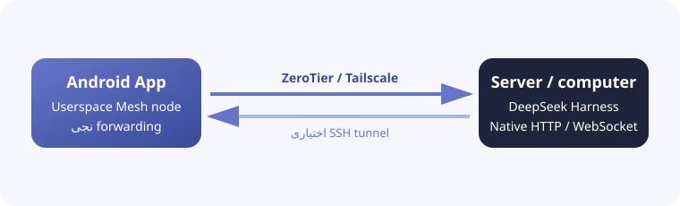

<h1 align="center">DSH Mobile Mesh</h1>

<a href="README.md">English</a> · <a href="README.zh-CN.md">中文</a> · <a href="README.hi.md">हिन्दी</a> · <a href="README.es.md">Español</a> · <a href="README.fr.md">Français</a> · <a href="README.ar.md">العربية</a> · <a href="README.bn.md">বাংলা</a> · <a href="README.pt.md">Português</a> · <a href="README.ru.md">Русский</a> · <b>اردو</b> · <a href="README.th.md">ไทย</a>

## خصوصیات

DSH Mobile Mesh، [DeepSeek Harness](https://github.com/deepseek-ai/deepseek-harness) کے لیے ایک غیر سرکاری Android ریموٹ ہے۔ Agent، Shell، فائلیں اور workspace اسی سرور پر چلتے ہیں جہاں DeepSeek Harness نصب ہے۔

- Workspaces، sessions، history اور live replies دیکھیں۔
- Tool نتائج دیکھیں اور text، images اور files بھیجیں۔
- Goals، plans، approvals، questions، jobs، workflows اور subagents سنبھالیں۔
- Models، presets اور skills تبدیل کریں اور DeepSeek Harness slash commands چلائیں۔

### Mesh کنکشن

ایپ Android میں ZeroTier/libzt یا Tailscale/tsnet userspace network بلٹ اِن چلاتی ہے اور DeepSeek Harness کے native HTTP/WebSocket interface کو فون پر forward کرتی ہے۔ DeepSeek Harness کے launch mode میں تبدیلی یا plugin کی ضرورت نہیں، اور Android system VPN بھی ضروری نہیں۔ SSH کو Direct، ZeroTier یا Tailscale تینوں کے ساتھ شامل کیا جا سکتا ہے، جس سے DeepSeek Harness `127.0.0.1` پر سن سکتا ہے۔

## استعمال

1. سرور پر `dsh web` چلائیں۔
2. ZeroTier یا Tailscale استعمال کرنے سے پہلے DeepSeek Harness والے سرور پر متعلقہ node انسٹال اور sign in کریں: [ZeroTier](https://www.zerotier.com/download/) انسٹال کرکے App والے network سے جڑیں، یا [Tailscale](https://tailscale.com/docs/install) انسٹال کرکے اسی Tailnet میں sign in کریں۔
3. [GitHub Releases](https://github.com/sorsama/deepseek-harness-mobile/releases) سے APK ڈاؤن لوڈ کریں۔
4. Direct، ZeroTier یا Tailscale منتخب کریں؛ SSH تینوں کے لیے اختیاری layer ہے۔
5. ضرورت پر DeepSeek Harness launch token درج کریں۔

## سیکیورٹی

DeepSeek Harness host پر commands چلا اور files پڑھ یا لکھ سکتا ہے۔ غیر محفوظ port کو public internet پر نہ کھولیں اور tokens، SSH keys اور Mesh identity محفوظ رکھیں۔

## مطابقت اور پروٹوکول baseline

Android ایپ کا پروٹوکول DTO baseline، DeepSeek Harness `v0.2.2-rc.1` (commit `66491b05e3`) کی پیروی کرتا ہے۔ wire types کو upstream `master` کے `fcc0ad4621` کے خلاف بھی جانچا گیا ہے، جو اُس release سے 811 commits آگے ہے اور خود کوئی release نہیں؛ جہاں اُس branch نے ایپ کی کال کردہ کوئی shape پہلے ہی بدل دی ہے، وہاں ایپ دونوں شکلیں برقرار رکھتی ہے۔ Settings اور connection details panel میں دکھایا گیا پروٹوکول baseline `v0.2.2-rc.1` release بتاتا ہے۔ کنکشن پر ایپ موجودہ read-only `session/list` اور `session/projections` probes استعمال کرتی ہے اور خودکار reconnect کے لیے مشاہدہ شدہ capabilities محفوظ کرتی ہے؛ سرور کے version string سے capabilities اخذ نہیں کرتی۔ projection route کے بغیر Host legacy subagent API کے ذریعے جاری رہتے ہیں۔

`v0.2.2-rc.1` ایپ کی پہلے سے کال کردہ ہر route کو برقرار رکھتا ہے، مگر تین request shapes بدلتا ہے۔ `session/attachment` اب صرف `attachmentId` کے بجائے مکمل `ImageAttachmentRef` لیتا ہے؛ Android دونوں members بھیجتا ہے، اور دونوں نسلوں کے Host وہ request member چھوڑ دیتے ہیں جس کا وہ اعلان نہیں کرتے، اس لیے image پڑھنے کے لیے کسی capability probe کی ضرورت نہیں۔ `session/follow` کسی prepared عام Session کو صرف اُس وقت resume کرتا ہے جب request میں `activate` سیٹ ہو؛ Android ہمیشہ activation طلب کرتا ہے، جس سے نئے Host پر 0.2.2 سے پہلے کا background-promotion رویہ بحال ہوتا ہے اور پرانے Host اسے نظرانداز کرتے ہیں، جبکہ subagent transcripts passive رہتے ہیں۔ `session/control` کے projection frames ایک committed event کے لیے متعدد key تبدیلیاں لے سکتے ہیں؛ ایپ legacy single-key frame کو normalize کرتی ہے اور دونوں قبول کرتی ہے۔ محدود `session/list` projection summary اب `imageLimits` جیسی host-wide قدریں دہراتا نہیں؛ ایپ انہیں `session/projections` اور control baseline سے پڑھتی ہے اور کبھی missing summary key کو missing capability نہیں سمجھتی۔ Host کا فراہم کردہ subagent catalog `name` موجودہ `label` کے ساتھ دکھایا جاتا ہے؛ جب پرانا Host اسے فراہم نہ کرے تو پہلے والا display برقرار رہتا ہے۔ catalog کے model badges ماڈل کے نام کے ساتھ دکھائے جاتے ہیں، اور جب قاری کی زبان موجود نہ ہو تو Host کا انگریزی متن استعمال ہوتا ہے؛ ناکام plugin اندراج Host کا بتایا ہوا startup diagnostic دکھاتا ہے۔ موجودہ Session کے `agentTeam` projection میں شائع Agent Team ٹاسک بورڈ تفصیلات پینل میں Host کی ترتیب سے render ہوتا ہے، جس میں Host کی تیاری، تحریری دائرے کی تنبیہات، اور جب کسی مسترد اپ ڈیٹ کے بعد بورڈ صرف آخری درست حالت ہو تو ایک نمایاں اطلاع شامل ہے؛ جس پرانے Host میں یہ projection نہیں، وہ کوئی بورڈ نہیں دکھاتا۔

تفصیلات کا پینل read-only `session/state` اور `session/observeState` stream کے ذریعے Host کی غیر فعال Session حالت بھی دکھاتا ہے: active/running flags، یہ کہ زیرِ التوا قطار پڑھی جا سکتی ہے یا نہیں اور اس میں کتنے آئٹمز ہیں، اور آخری بار حالت پڑھنے پر لیے گئے pending-input زمرے۔ صارف کی شروع کردہ «زیادہ سے زیادہ 20 سیکنڈ انتظار کریں» ایک بار `session/wait` کال کرتی ہے، Host کی `idle`، `input-required` یا `timeout` وجہ بتاتی ہے، assistant آؤٹ پٹ کے کٹے جانے کی نشاندہی کرتی ہے، اور Session کو کبھی نہیں روکتی؛ transport سطح پر ناکام انتظار کو ناکامی کے طور پر دکھایا جاتا ہے، کبھی Host timeout کے طور پر نہیں۔ متاثرہ سطح صرف اُس وقت چھپتی ہے جب Host اپنے متعلقہ endpoint کے لیے منظم missing route کا جواب دیتا ہے، اور permission یا غیر متعلقہ خامیاں پرانے Host کے طور پر سمجھنے کے بجائے خامیوں کے طور پر دکھائی جاتی ہیں۔

تاریخ کی pagination اور subagent preview پڑھنے کے لیے ایپ read-only `session/events` کو ترجیح دیتی ہے۔ صرف اِس route کے خود غائب ہونے کے ثبوت پر fallback ہوتا ہے — stream پر gateway کی missing-endpoint error، یا unary call پر shared handler کا HTTP 404: pagination کے لیے `session/page` اور subagent preview کے لیے `session/follow` کا پہلا frame استعمال ہوتا ہے۔ timeout اور permission errors fallback کا سبب نہیں بنتے۔ مختلف semantics کی وجہ سے مرکزی session کے snapshot اور live state کے لیے `session/follow` اور `session/control` بدستور استعمال ہوتے ہیں۔

مکمل شدہ `apply_patch` نتیجہ صرف وہ hunks دکھاتا ہے جنہیں Host بتاتا ہے کہ لاگو کیے گئے؛ جب پیچ وقت سے پہلے رک گیا ہو تو کارڈ یہ واضح کرتا ہے اور Host کی اپنی رکی ہوئی کارروائی کی تفصیل برقرار رکھتا ہے، جبکہ چلتی کال، خرابی یا metadata کی عدم موجودگی میں عمومی نتیجہ متن ہی رہتا ہے۔

مزید دو wire تبدیلیاں دفاعی انداز میں نمٹائی جاتی ہیں۔ upstream `master` نے کسی بھی release میں شامل ہونے سے پہلے `subagents/interruptByParent` کا نام بدل کر ایک argument والا `subagents/interruptByUser` کر دیا؛ ایپ user شکل استعمال کرتی ہے جب Host اُس کا جواب دے اور صرف اُس وقت parent شکل پر واپس آتی ہے جب Host بتاتا ہے کہ وہ route خود موجود نہیں، اس لیے subagent روکنا جاری شدہ Host اور موجودہ `master` builds دونوں پر کام کرتا ہے۔ `userQuestions` request نئی `approval` presentation intent لے سکتی ہے؛ ایپ اُس variant کو عام question card کے طور پر decode کرتی ہے، اور مستقبل کی نامعلوم intent بھی اُسی عام flow میں ڈھل جاتی ہے بجائے request کو ضائع کرنے کے۔

اپنایا گیا 0.2.1 baseline `workspace/follow` کو بھی شامل کرتا ہے: پرانا `baseline` اور نیا `replace` دونوں workspace، archive اور pin ترتیب مکمل طور پر بدلتے ہیں۔ read-only `session/list` اور `session/projections` probes برقرار ہیں؛ `session/create.sessionId` بطور default حذف ہوتا ہے اور واپس آنے والا ID استعمال ہوتا ہے۔ read-only `terminal/environment.maxBufferedBytes` فیلڈ نئے دو طرفہ `terminal/attach` stream کو منتخب کرتی ہے؛ پرانے Host میں اس کے بغیر `terminal/follow` اور write/resize راستے برقرار رہتے ہیں۔ ہر attachment میں نمبر شدہ command اگلی command سے پہلے Host acknowledgement کا انتظار کرتی ہے اور transport window کی حد جانچتی ہے۔ `terminal/list` کا نتیجہ فی session cache ہوتا ہے اور اسی session کے تمام terminal views اسے مشترکہ استعمال کرتے ہیں؛ ہر نئی connection generation پر ایک بار دوبارہ لوڈ ہوتا ہے، create اور تصدیق شدہ close cached rows کو درست کرتے ہیں، اور terminal metadata کا واحد ماخذ Host response ہی رہتا ہے۔

اصل بائٹس لے جانے والے Remote نتائج `multipart/form-data` کے طور پر آتے ہیں: `metadata` حصہ عام server-response envelope رکھتا ہے جس میں ہر بائٹ فیلڈ `null` چھوڑا جاتا ہے، اور باقی بائنری حصے ڈی کوڈ کرنے سے پہلے اُن فیلڈز میں واپس جوڑ دیے جاتے ہیں۔ workspace بائٹ ریڈز — اور اسی لیے ایپ Markdown پیغامات کے اندر جو workspace تصاویر دکھاتی ہے — یہی راستہ استعمال کرتی ہیں، اس لیے یہ Harness 0.2.0 اور اُس کے بعد کے Host پر بھی کام کرتی رہتی ہیں؛ جو Host اب بھی JSON بائٹ اری یا base64 اسٹرنگ کے ساتھ جواب دیتا ہے وہ پہلے کی طرح ڈی کوڈ ہوتا ہے۔

ایپ پرانے projection responses جن میں `kind` نہیں ہوتا اور نئے `session/projections` variants دونوں قبول کرتی ہے۔ `migration-required` کو sequence کے بغیر hint سمجھا جاتا ہے اور اسے live event watermarks میں merge نہیں کیا جاتا۔ `session/list.formatStatus` اختیاری ہے؛ پرانے Host compatibility کے لیے `session/fork.allowMigration` بطورِ default نہیں بھیجا جاتا۔ `external` mode والے subagent records سرور کی فراہم کردہ metadata کے ساتھ دکھائے جاتے ہیں، مگر Session transcript کے طور پر نہیں کھلتے۔ `terminal/environment.cwd` Host کا درج کردہ موجودہ directory ہے۔

Android گفتگو کی فہرست اب Host کی ملکیت والے خودکار کام کھولتی ہے۔ read-only `schedule/catalog` request دستیابی جانچتی ہے؛ صرف missing-route جواب کسی Host کو Schedule support کے بغیر نشان زد کرتا ہے۔ `v0.2.2-rc.1` نے task mutation کو `schedule/edit` پر منتقل کیا اور catalog rows کو delivery `target`، `active`/`paused`/`ended` status اور `updatedAt` revision دیا۔ ایپ جدید edit route کی کوشش کرتی ہے اور صرف اُس وقت `schedule/update` اور `schedule/delete` پر واپس آتی ہے جب Host بتاتا ہے کہ وہ route خود موجود نہیں، اور نتیجہ connection generation کے لیے یاد رکھتی ہے: جدید راستہ مشاہدہ شدہ `updatedAt` کو `expectedUpdatedAt` کے طور پر بھیجتا ہے، row سے target Session کھولتا ہے اور نئے statuses دکھاتا ہے، جبکہ legacy راستہ مکمل مشاہدہ شدہ rule کو `expected` کے طور پر رکھتا ہے۔ catalog row کی دونوں شکلیں decode ہوتی ہیں، اس لیے پرانے اور نئے Host ایک ہی فہرست render کرتے ہیں۔ جب Host نئے مینجمنٹ routes فراہم کرتا ہے تو ایپ براہِ راست `schedule/create` سے کام بناتی ہے — موجودہ Session میں، پہلی ترسیل پر بنائے گئے ایک Session میں، یا ہر ترسیل پر نئے Session میں — `schedule/edit` کے ذریعے اسے روکتی اور دوبارہ شروع کرتی ہے، `schedule/run` سے شیڈول بدلے بغیر ایک بار چلاتی ہے، اور ایک تصدیق شدہ `schedule/deleteInactive` کال میں ختم شدہ کام حذف کرتی ہے؛ `schedule/deliveryLimits` وہ کم از کم نئے-Session وقفہ فراہم کرتا ہے جو Host نافذ کرتا ہے۔ ہر ناکامی کو ثبوت سے درجہ بندی کیا جاتا ہے: missing route صرف اُسی کارروائی کو متاثر کرتا ہے اور اسے غیر معاون بتایا جاتا ہے، Host کی کاروباری مستردگی Host کے اپنے پیغام کے ساتھ دکھائی جاتی ہے، اور صرف transport سطح کی ناکامیاں ہی نامعلوم نتیجہ کے طور پر بتائی جاتی ہیں جسے قاری کو دوبارہ کوشش سے پہلے تازہ کرنا ہوتا ہے۔ جب یہ routes موجود نہ ہوں تو creation پھر بھی Web کی طرح ایک Session شروع کرتی ہے اور reminders اس کے Agent سے کہہ کر بنائے جاتے ہیں۔ Host catalog search/filter APIs دستیاب نہیں، اس لیے Android الگ client-side search یا status filter ایجاد نہیں کرتا۔

## حوالہ جات

- [DeepSeek Harness](https://github.com/deepseek-ai/deepseek-harness)
- [OpenCode Mobile Mesh](https://github.com/chliny/opencode-mobile-mesh)
- [DeepSeek Harness Mobile](https://github.com/sorsama/deepseek-harness-mobile)

## لائسنس

[MIT License](LICENSE)۔ DeepSeek Harness اور اس کی branding متعلقہ مالکان کی ملکیت ہیں۔
