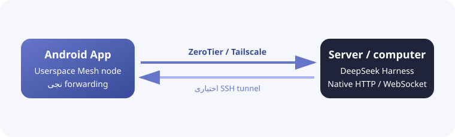

<h1 align="center">DSH Mobile Mesh</h1>

<a href="README.md">English</a> · <a href="README.zh-CN.md">中文</a> · <a href="README.hi.md">हिन्दी</a> · <a href="README.es.md">Español</a> · <a href="README.fr.md">Français</a> · <a href="README.ar.md">العربية</a> · <a href="README.bn.md">বাংলা</a> · <a href="README.pt.md">Português</a> · <a href="README.ru.md">Русский</a> · <b>اردو</b> · <a href="README.th.md">ไทย</a>

## خصوصیات

DSH Mobile Mesh، [DeepSeek Harness](https://github.com/deepseek-ai/deepseek-harness) کے لیے ایک غیر سرکاری Android ریموٹ ہے۔ Agent، Shell، فائلیں اور workspace اسی سرور پر چلتے ہیں جہاں DeepSeek Harness نصب ہے۔

- Workspaces، sessions، history اور live replies دیکھیں۔
- Tool نتائج دیکھیں اور text، images اور files بھیجیں۔
- Goals، plans، approvals، questions، jobs، workflows اور subagents سنبھالیں۔
- Models، presets اور skills تبدیل کریں اور DeepSeek Harness slash commands چلائیں۔

### Mesh کنکشن

ایپ Android میں ZeroTier/libzt یا Tailscale/tsnet userspace network بلٹ اِن چلاتی ہے اور DeepSeek Harness کے native HTTP/WebSocket interface کو فون پر forward کرتی ہے۔ DeepSeek Harness کے launch mode میں تبدیلی یا plugin کی ضرورت نہیں، اور Android system VPN بھی ضروری نہیں۔ SSH کو Direct، ZeroTier یا Tailscale تینوں کے ساتھ شامل کیا جا سکتا ہے، جس سے DeepSeek Harness `127.0.0.1` پر سن سکتا ہے۔

## استعمال

1. سرور پر `dsh web` چلائیں۔
2. ZeroTier یا Tailscale استعمال کرنے سے پہلے DeepSeek Harness والے سرور پر متعلقہ node انسٹال اور sign in کریں: [ZeroTier](https://www.zerotier.com/download/) انسٹال کرکے App والے network سے جڑیں، یا [Tailscale](https://tailscale.com/docs/install) انسٹال کرکے اسی Tailnet میں sign in کریں۔
3. [GitHub Releases](https://github.com/sorsama/deepseek-harness-mobile/releases) سے APK ڈاؤن لوڈ کریں۔
4. Direct، ZeroTier یا Tailscale منتخب کریں؛ SSH تینوں کے لیے اختیاری layer ہے۔
5. ضرورت پر DeepSeek Harness launch token درج کریں۔

## سیکیورٹی

DeepSeek Harness host پر commands چلا اور files پڑھ یا لکھ سکتا ہے۔ غیر محفوظ port کو public internet پر نہ کھولیں اور tokens، SSH keys اور Mesh identity محفوظ رکھیں۔

## مطابقت اور پروٹوکول baseline

Android DTO baseline، DeepSeek Harness `v0.2.1-alpha.2` کے session اور terminal API contracts کے مطابق ہے۔ کنکشن کے وقت ایپ موجودہ read-only `session/list` اور `session/projections` probes استعمال کرتی ہے اور reconnect کے لیے معلوم capabilities محفوظ کرتی ہے؛ سرور کے version string سے support اخذ نہیں کرتی۔ اگر پرانے Host میں projection route نہ ہو تو ایپ legacy subagent API استعمال کرتی رہتی ہے۔

ایپ `workspace/follow` کے لیے commit `86a402200d` بھی استعمال کرتی ہے: پرانا `baseline` اور نیا `replace` دونوں workspace، archive اور pin ترتیب مکمل طور پر بدلتے ہیں۔ read-only `session/list` اور `session/projections` probes برقرار ہیں؛ `session/create.sessionId` بطور default حذف ہوتا ہے اور واپس آنے والا ID استعمال ہوتا ہے۔ read-only `terminal/environment.maxBufferedBytes` فیلڈ نئے دو طرفہ `terminal/attach` stream کو منتخب کرتی ہے؛ پرانے Host میں اس کے بغیر `terminal/follow` اور write/resize راستے برقرار رہتے ہیں۔ ہر attachment میں نمبر شدہ command اگلی command سے پہلے Host acknowledgement کا انتظار کرتی ہے اور transport window کی حد جانچتی ہے۔

ایپ پرانے projection responses جن میں `kind` نہیں ہوتا اور نئے `session/projections` variants دونوں قبول کرتی ہے۔ `migration-required` کو sequence کے بغیر hint سمجھا جاتا ہے اور اسے live event watermarks میں merge نہیں کیا جاتا۔ `session/list.formatStatus` اختیاری ہے؛ پرانے Host compatibility کے لیے `session/fork.allowMigration` بطورِ default نہیں بھیجا جاتا۔ `external` mode والے subagent records سرور کی فراہم کردہ metadata کے ساتھ دکھائے جاتے ہیں، مگر Session transcript کے طور پر نہیں کھلتے۔ `terminal/environment.cwd` Host کا درج کردہ موجودہ directory ہے۔

## حوالہ جات

- [DeepSeek Harness](https://github.com/deepseek-ai/deepseek-harness)
- [OpenCode Mobile Mesh](https://github.com/chliny/opencode-mobile-mesh)
- [DeepSeek Harness Mobile](https://github.com/sorsama/deepseek-harness-mobile)

## لائسنس

[MIT License](LICENSE)۔ DeepSeek Harness اور اس کی branding متعلقہ مالکان کی ملکیت ہیں۔
