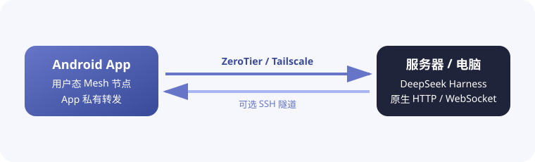

<h1 align="center">DSH Mobile Mesh</h1>

<a href="README.md">English</a> · <b>中文</b> · <a href="README.hi.md">हिन्दी</a> · <a href="README.es.md">Español</a> · <a href="README.fr.md">Français</a> · <a href="README.ar.md">العربية</a> · <a href="README.bn.md">বাংলা</a> · <a href="README.pt.md">Português</a> · <a href="README.ru.md">Русский</a> · <a href="README.ur.md">اردو</a> · <a href="README.th.md">ไทย</a>

## 功能特性

DSH Mobile Mesh 是 [DeepSeek Harness](https://github.com/deepseek-ai/deepseek-harness) 的非官方 Android 远程控制端。Agent、Shell、文件和工作区继续运行在安装 DeepSeek Harness 的服务器上。

- 查看工作区、会话、历史消息和实时回复。
- 查看工具结果，发送文字、图片和文件；代码文件按页读取并按可见区域高亮，常见配置、标记和样式文件也支持着色。
- 管理目标、计划、待办、审批、提问、任务、工作流和子代理。
- 切换模型、预设和技能，执行 DeepSeek Harness 斜杠命令。
- 搜索会话、查看轨迹和用量、导出日志并接收通知。

### Mesh 连接

App 在 Android 内置运行 ZeroTier/libzt 或 Tailscale/tsnet 用户态网络，将 DeepSeek Harness 原生 HTTP/WebSocket 接口转发到手机。DeepSeek Harness 无需修改启动方式或安装插件，也不需要 Android 系统级 VPN。直连、ZeroTier 和 Tailscale 都可以叠加 SSH 转发，让 DeepSeek Harness 保持监听 127.0.0.1。

## 使用方法

1. 在服务器上按官方方式启动 DeepSeek Harness：`dsh web`。
2. 使用 ZeroTier 或 Tailscale 前，先在运行 DeepSeek Harness 的服务器上部署并登录对应节点：安装 [ZeroTier](https://www.zerotier.com/download/) 并加入与 App 相同的网络，或安装 [Tailscale](https://tailscale.com/docs/install) 并登录同一 Tailnet。
3. 从 [GitHub Releases](https://github.com/sorsama/deepseek-harness-mobile/releases) 下载并安装最新 APK。
4. 在 App 中选择直连、ZeroTier 或 Tailscale；SSH 是三者都可以叠加的可选传输层。
5. 按提示输入 DeepSeek Harness 启动令牌。

## 安全提示

DeepSeek Harness 可以在主机上执行命令和读写文件。请优先使用 ZeroTier、Tailscale 或 SSH，不要将未保护的 DeepSeek Harness 端口暴露到公网，并保护启动令牌、SSH 密钥和 Mesh 身份数据。

## 兼容版本与协议基线

Android App 协议 DTO 基线跟踪 DeepSeek Harness `v0.2.1-alpha.2` 的旧版 session 与 terminal 载荷，以及提交 `86a402200d` 的 `workspace/follow`、会话创建和双向终端 API。连接时通过现有只读 `session/list` 和 `session/projections` 探测接口，并缓存观测到的能力供自动重连使用；不会根据服务器版本字符串推断能力。没有 projection 接口的旧 Host 仍走旧版 subagent API。

`workspace/follow` 同时接受旧版开场 `baseline` 和新版完整 `replace` 增量；两者均完整替换工作区列表、归档集合与置顶顺序。既有只读能力探测继续选择旧版 session 接口，只有结构化的路由不存在证据才判定不支持。`session/create` 默认省略可选 `sessionId` 并使用服务端返回的 ID。通过只读 `terminal/environment.maxBufferedBytes` 字段选择新版 `terminal/attach` 双向流；旧 Host 未提供该字段时保留 `terminal/follow` 及原有 write/resize 接口。新版命令在每次附着中递增编号，收到 Host 回执后才发送下一条，并在发送前检查传输窗口容量。

App 同时接受旧版 projection 响应（只有 `asOfSeq`、`values`，没有 `kind`）和当前 `session/projections` 响应。`migration-required` 响应只作为无序号提示处理，不会与实时事件水位合并。新版 `session/list.formatStatus` 为可选字段；`session/fork.allowMigration` 未显式请求时继续省略，以保留旧 Host 行为。catalog 新增的 `external` 子代理模式会按服务端数据展示，但不会当作可导航的会话 transcript。`terminal/environment.cwd` 表示 Host 记录的当前目录，终端元数据仍以 Host 返回为准。

## 参考

- [DeepSeek Harness](https://github.com/deepseek-ai/deepseek-harness)
- [OpenCode Mobile Mesh](https://github.com/chliny/opencode-mobile-mesh)
- [DeepSeek Harness Mobile](https://github.com/sorsama/deepseek-harness-mobile)

## 许可证

[MIT License](LICENSE)。DeepSeek Harness 及其品牌归各自权利人所有；本项目是独立的社区项目。
