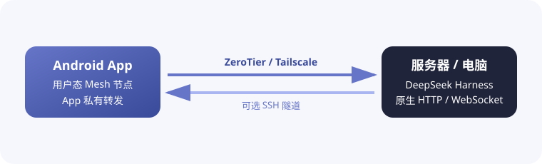

<h1 align="center">DSH Mobile Mesh</h1>

<a href="README.md">English</a> · <b>中文</b> · <a href="README.hi.md">हिन्दी</a> · <a href="README.es.md">Español</a> · <a href="README.fr.md">Français</a> · <a href="README.ar.md">العربية</a> · <a href="README.bn.md">বাংলা</a> · <a href="README.pt.md">Português</a> · <a href="README.ru.md">Русский</a> · <a href="README.ur.md">اردو</a> · <a href="README.th.md">ไทย</a>

## 功能特性

DSH Mobile Mesh 是 [DeepSeek Harness](https://github.com/deepseek-ai/deepseek-harness) 的非官方 Android 远程控制端。Agent、Shell、文件和工作区继续运行在安装 DeepSeek Harness 的服务器上。

- 查看工作区、会话、历史消息和实时回复。
- 查看工具结果，发送文字、图片和文件；代码文件按页读取并按可见区域高亮，常见配置、标记和样式文件也支持着色。
- 管理目标、计划、待办、审批、提问、任务、工作流和子代理。
- 切换模型、预设和技能，执行 DeepSeek Harness 斜杠命令。
- 搜索会话、查看轨迹和用量、导出日志并接收通知。

### Mesh 连接

App 在 Android 内置运行 ZeroTier/libzt 或 Tailscale/tsnet 用户态网络，将 DeepSeek Harness 原生 HTTP/WebSocket 接口转发到手机。DeepSeek Harness 无需修改启动方式或安装插件，也不需要 Android 系统级 VPN。直连、ZeroTier 和 Tailscale 都可以叠加 SSH 转发，让 DeepSeek Harness 保持监听 127.0.0.1。

## 使用方法

1. 在服务器上按官方方式启动 DeepSeek Harness：`dsh web`。
2. 使用 ZeroTier 或 Tailscale 前，先在运行 DeepSeek Harness 的服务器上部署并登录对应节点：安装 [ZeroTier](https://www.zerotier.com/download/) 并加入与 App 相同的网络，或安装 [Tailscale](https://tailscale.com/docs/install) 并登录同一 Tailnet。
3. 从 [GitHub Releases](https://github.com/sorsama/deepseek-harness-mobile/releases) 下载并安装最新 APK。
4. 在 App 中选择直连、ZeroTier 或 Tailscale；SSH 是三者都可以叠加的可选传输层。
5. 按提示输入 DeepSeek Harness 启动令牌。

## 安全提示

DeepSeek Harness 可以在主机上执行命令和读写文件。请优先使用 ZeroTier、Tailscale 或 SSH，不要将未保护的 DeepSeek Harness 端口暴露到公网，并保护启动令牌、SSH 密钥和 Mesh 身份数据。

## 兼容版本与协议基线

Android App 协议 DTO 基线跟踪 DeepSeek Harness `v0.2.2-rc.1`（提交 `66491b05e3`）。线协议类型同时对照了上游 `master` 的 `fcc0ad4621`（该发布之后另有 811 个提交，本身不是发布版本）；若该分支已经改动了 App 调用的形状，App 会同时保留新旧两种形态。设置页与连接详情面板显示的协议基线为 `v0.2.2-rc.1` 发布版本。连接时通过现有只读 `session/list` 和 `session/projections` 探测接口，并缓存观测到的能力供自动重连使用；不会根据服务器版本字符串推断能力。没有 projection 接口的旧 Host 仍走旧版 subagent API。

`v0.2.2-rc.1` 保留了 App 已调用的全部路由，但改动了三处请求/流形状。`session/attachment` 改为接收完整 `ImageAttachmentRef`，不再接受单独的 `attachmentId`；Android 同时发送两个字段，新旧 Host 都会丢弃自己未声明的请求字段，因此图片读取不需要额外能力探测。`session/follow` 只有请求显式设置 `activate` 才会恢复 prepared 的普通会话；Android 始终请求激活，使新 Host 恢复 0.2.2 之前的后台提升行为，旧 Host 会忽略该字段，而子代理 transcript 保持被动。`session/control` 的投影帧可在一个已提交事件中携带多个键变更；App 会把旧版单键帧归一化，两种形状都接受。收窄后的 `session/list` 投影摘要不再重复 `imageLimits` 这类全 Host 共用的值；App 改从 `session/projections` 与控制基线读取，且绝不会把摘要键缺失当作能力缺失。Host 提供的子代理 catalog `name` 会与现有 `label` 一起展示；旧 Host 未提供时维持原有显示。catalog 中的模型 badge 会显示在模型名旁；当前阅读语言缺失时使用 Host 提供的英文文本。启动失败的插件条目会显示 Host 上报的诊断原文。当前会话 `agentTeam` 投影中的 Agent Team 任务板会在详情面板按 Host 顺序展示，包含 Host 计算的就绪状态、写入范围警告，以及更新被拒绝后仅剩最后有效状态时的显著提示；旧 Host 没有该投影时不显示任务板。

详情面板还通过只读 `session/state` 与 `session/observeState` 流展示 Host 的会话被动状态：active/running 标志、待处理队列是否可读及其条数，以及最近一次状态读取时采样到的待处理输入类别。用户主动点击“最多等待 20 秒”时只调用一次 `session/wait`，展示 Host 返回的 `idle`、`input-required` 或 `timeout` 原因，并提示助手输出是否被截断；等待结束不会停止会话，传输层失败按失败展示，绝不会冒充 Host 超时。只有 Host 对相应接口返回结构化缺路由响应时才隐藏对应界面；权限或其他无关错误按错误显示，不会当作旧 Host。

App 读取历史分页和子代理预览时优先使用只读 `session/events`；只有确认该接口本身不存在的证据才回退——流式路由由网关返回缺端点错误，一元调用则由共享处理器返回 HTTP 404：分页使用 `session/page`，子代理预览使用 `session/follow` 的首帧。超时和权限错误不会触发回退。由于语义不同，`session/follow` 和 `session/control` 继续用于主会话快照与实时状态。

`apply_patch` 完成后只展示 Host 上报的实际已应用变更；补丁提前停止时卡片会明确标注部分应用，并保留 Host 自己的停止/失败说明；运行中、出错或缺少元数据时继续使用通用结果文本。

另外两处线协议变化按防御方式处理。上游 `master` 在任何发布版本包含之前，就把 `subagents/interruptByParent` 改名为只接收一个参数的 `subagents/interruptByUser`；App 在 Host 接受用户态接口时使用它，仅在 Host 明确报告该路由不存在时回退到旧版 parent 接口，因此停止子代理在已发布 Host 与当前 `master` 构建上都可用。`userQuestions` 请求可能携带新的 `approval` 展示意图；App 会按通用问题卡片解码该变体，未来未知意图也降级为同样的通用流程，而不会丢弃整个请求。

已采纳的基线同样覆盖 `workspace/follow`：同时接受旧版开场 `baseline` 和完整 `replace` 增量，两者均完整替换工作区列表、归档集合与置顶顺序。既有只读能力探测继续选择旧版 session 接口，只有结构化的路由不存在证据才判定不支持。`session/create` 默认省略可选 `sessionId` 并使用服务端返回的 ID。通过只读 `terminal/environment.maxBufferedBytes` 字段选择新版 `terminal/attach` 双向流；旧 Host 未提供该字段时保留 `terminal/follow` 及原有 write/resize 接口。新版命令在每次附着中递增编号，收到 Host 回执后才发送下一条，并在发送前检查传输窗口容量。 `terminal/list` 发现结果按会话缓存，并供该会话的所有终端视图共享，每个新连接代重新加载一次；创建与已确认的关闭会修正缓存行，终端元数据始终只以 Host 响应为准。

携带原生字节的 Remote 结果以 `multipart/form-data` 返回：`metadata` 部分是普通 server-response 信封（各字节字段为 `null`），其余二进制分片会在解码前填回这些字段。工作区字节读取（以及 App 在 Markdown 消息中展示的工作区图片）走这条路径，因此在 Harness 0.2.0 及以后的 Host 上仍然可用；仍以 JSON 字节数组或 base64 字符串返回的 Host 也按原方式解码。

App 同时接受旧版 projection 响应（只有 `asOfSeq`、`values`，没有 `kind`）和当前 `session/projections` 响应。`migration-required` 响应只作为无序号提示处理，不会与实时事件水位合并。新版 `session/list.formatStatus` 为可选字段；`session/fork.allowMigration` 未显式请求时继续省略，以保留旧 Host 行为。catalog 新增的 `external` 子代理模式会按服务端数据展示，但不会当作可导航的会话 transcript。`terminal/environment.cwd` 表示 Host 记录的当前目录，终端元数据仍以 Host 返回为准。

Android 会话列表现可打开 Host 管理的自动化任务。只读 `schedule/catalog` 请求检查能力；只有缺路由响应才将不支持 Schedule 的 Host 判为不可用。`v0.2.2-rc.1` 将任务变更迁移到 `schedule/edit`，并让 catalog 行携带投递 `target`、`active`/`paused`/`ended` 状态与 `updatedAt` 修订号。App 先尝试新版 edit 路由，仅在 Host 明确报告该路由不存在时回退到 `schedule/update` 与 `schedule/delete`，并在当前连接代内记住结果：新版路径把观测到的 `updatedAt` 作为 `expectedUpdatedAt` 发送、按行内 target 打开会话并展示新状态；旧版路径继续以完整观测规则作为 `expected`。两种 catalog 行形状都可解码，因此新旧 Host 渲染同一份列表。当 Host 提供新版管理路由时，App 直接通过 `schedule/create` 创建任务——可投递到现有会话、首次投递时创建的一个会话，或每次投递新建会话——通过 `schedule/edit` 暂停与恢复，用 `schedule/run` 立即执行一次且不改变原计划，并通过一次确认的 `schedule/deleteInactive` 删除已结束任务；`schedule/deliveryLimits` 提供 Host 为新会话设定的最小间隔。每类失败都按证据区分：缺路由只影响对应操作并提示不支持，Host 的业务拒绝原样展示其消息，只有传输层失败才提示结果未知、需刷新后再试。相关路由不存在时，新建任务仍与网页端相同先启动会话，再由 Agent 创建提醒。Host 尚无目录搜索或状态过滤 API，因此 Android 不自行实现另一套客户端筛选。

## 参考

- [DeepSeek Harness](https://github.com/deepseek-ai/deepseek-harness)
- [OpenCode Mobile Mesh](https://github.com/chliny/opencode-mobile-mesh)
- [DeepSeek Harness Mobile](https://github.com/sorsama/deepseek-harness-mobile)

## 许可证

[MIT License](LICENSE)。DeepSeek Harness 及其品牌归各自权利人所有；本项目是独立的社区项目。
